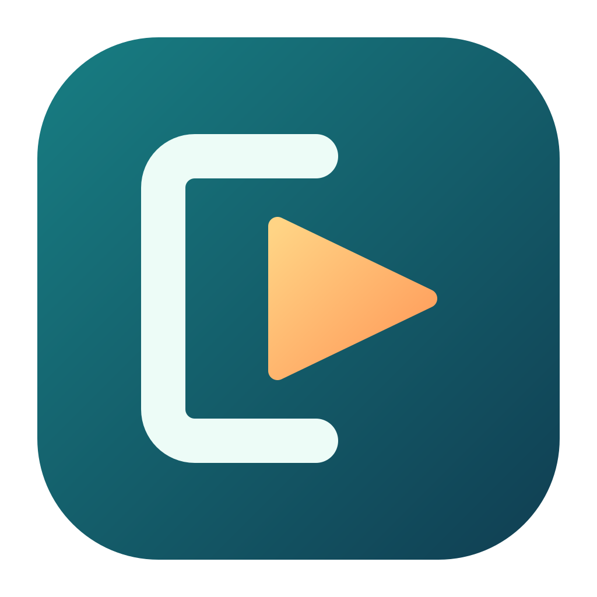
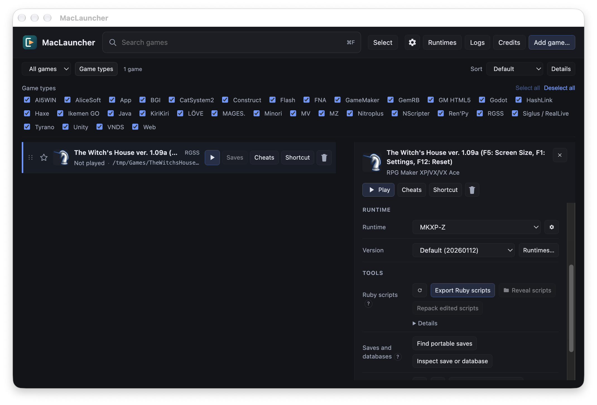

# MacLauncher

a macOS app to easily launch various games natively and tinker with them.



## Idea

A surprising number of games have runtimes that are available on macOS (and Linux) even though the games themselves are packaged for Windows and don't work out of the box. These games don't require WINE or emulation, and running natively can gain you higher performance and (sometimes) better compatibility. The purpose of this launcher is to configure these native runtimes automatically so you can just drag in a game directory or exe and start playing.

This launcher started by taking the patches in https://github.com/bakustarver/rpgmakermlinux-cicpoffs to macOS and wrapping it all in a UI, although I have added many more features since then. It has now gotten to the point where **a nontrivial proportion of indie games meant for windows can just be dragged in and played** (at least with the sampling bias of "indie games I personally thought of"). Still, compatibility is at the level of "try it" for many things.

## Why use MacLauncher?

There are quite a few benefits to using native macOS runtimes for games, even when CrossOver compatibility is quite good and some developers distribute native mac builds.
- Games are generally more performant and efficient running under native runtimes compared to CrossOver/WINE.
- Compatibility is often better on native runtimes as well, although sometimes it goes the other way.
- Native runtimes have better OS integration (window management, mouse behavior, etc). I have had so much more "erratic" behavior (mouse movements not feeling right, windowed vs fullscreen mode issues or blocks, kind of corrupted sound, etc) on CrossOver, so in practice, if a game can launch in MacLauncher, I prefer to use it.
- Many .app deployments for indie games (e.g. itch.io) are broken because the developer just clicked "build for mac" and Apple notarization quirks tell you you can't open the game. Running with a properly signed SDK solves this issue for good.

In addition, MacLauncher contains a suite of tools for extracting, decompiling, adding cheats into many of the game types it supports, some of which are unique and custom written for the MacLauncher project. You can also choose exactly which version of each backend you want to use from live listings: e.g. Godot is often particular about versions, and matching the major+minor version of every specific game is recommended. To make it more convenient, version detection happens automatically.

MacLauncher is different from many other game launchers in that it is **local first** (provide your own game files), with no integrations with storefronts, and will never connect to the internet at all except for downloading and managing remote runtime versions. It is more of a manager/power tool geared towards tinkerers rather a traditional launcher.

The app itself is written in Electron so that web games don't require any additional downloads.


## Game support

MacLauncher now supports quite a few types of games:

- **macOS apps:** you can import and manage these, and also remove Apple quarantine so badly packaged games can run without showing as "damaged".
- **RPGMaker:** MV/MZ through [Electron](https://github.com/electron/electron) or [NW.js](https://github.com/nwjs/nw.js), XP/VX/VX Ace through [MKXP-Z](https://github.com/mkxp-z/mkxp-z).
- **HTML games:** similarly to RPGMaker MV/MZ, most games based on web technologies will "just work", including Construct, TyranoBuilder and GameMaker HTML5.
- **Ren'Py**
- **Godot**
- **LÖVE**
- **GameMaker:** you can use the official GameMaker runtime, or alternatively, [Butterscotch](https://github.com/ButterscotchRunner/Butterscotch) for GameMaker Studio and [OpenGMK](https://github.com/OpenGMK/OpenGMK) for GameMaker classic (custom macOS port).
- **Unity:** Mono games can usually run through the macOS Unity player and are supported in MacLauncher. Il2Cpp translates everything into system calls so you need CrossOver for that.
- **XNA/FNA:** with [FNA](https://github.com/FNA-XNA/FNA), [FNA3D](https://github.com/FNA-XNA/FNA3D), [FAudio](https://github.com/FNA-XNA/FAudio) and [.NET](https://github.com/dotnet/runtime).
- **Flash (`.swf`):** via Adobe Flash Projector or [Ruffle](https://github.com/ruffle-rs/ruffle)
- **Java:** with [Temurin](https://github.com/adoptium/temurin-build) version mangaement, [Vineflower](https://github.com/Vineflower/vineflower) decompilation, and [steamworks4j](https://github.com/code-disaster/steamworks4j).
- **Infinity Engine:** [GemRB](https://github.com/gemrb/gemrb).
- **MUGEN:** [Ikemen GO](https://github.com/ikemen-engine/Ikemen-GO).
- **Haxe:** [HashLink](https://github.com/HaxeFoundation/hashlink).
- **Visual novels**: there are a lot. Surprisingly many VN engines get cross-platform runtimes. Here is what MacLauncher currently supports:
  - **NScripter:** [Onscripter-Yuri](https://github.com/YuriSizuku/OnscripterYuri), and a custom macOS port of [ONScripter-EN](https://github.com/Galladite27/ONScripter-EN).
  - **KiriKiri / KAG:** [krkrsdl2](https://github.com/krkrsdl2/krkrsdl2) and [KAG3](https://github.com/krkrsdl2/kag3).
  - **MAGES:** [Impacto](https://github.com/CommitteeOfZero/impacto)
  - **AI5WIN:** [AI5-SDL2](https://github.com/nunuhara/ai5-sdl2).
  - **AliceSoft:** [System3](https://github.com/kichikuou/system3-sdl2), [xsystem35](https://github.com/kichikuou/xsystem35-sdl2), and [xsystem4](https://github.com/nunuhara/xsystem4).
  - **Siglus / RealLive:** [siglus_rs](https://github.com/xmoezzz/siglus_rs) and [RLVM](https://github.com/eglaysher/rlvm).
  - **Nitroplus:** [NPengine](https://github.com/FGRE/libnpengine) and [libnpa](https://github.com/FGRE/libnpa).
  - **Minori:** [ReMinori](https://github.com/luoyily/ReMinori).
  - **VNDS:** [VNDS-LOVE](https://github.com/ajusa/VNDS-LOVE).

Many of these also have decompilation and/or save editing tools. Some backends, like CatSystem2 and BGI, aren't currently working for play but can be detected/decompiled. See [runtime guides](docs/runtimes/README.md) for more information.

## Unique features

Most of MacLauncher is about consolidating existing tools and runtimes and handling things for the user, but there is also a significant amount of functionality that you can't find anywhere else. Here are some highlights:
- Custom RPGMaker cheats, which I prefer over any other ones I've found on GitHub.
- A port of [OpenGMK to macOS](docs/runtimes/GAMEMAKER.md#classic-opengmk-native-beta): involving AppKit input/windows, OpenGL, CoreAudio and original-read/private-write handling. As far as I know, this is the only way to get GameMaker classic games running natively on mac.
- An [Impacto Windows adapter](docs/runtimes/MAGES.md): basically, meaning you can play from Windows-packaged games and not just Playstation, and you can download STEINS;GATE from steam, drag it in, and play.
- Custom macOS ports of [ONScripter-EN](docs/runtimes/NSCRIPTER.md), [AI5],(docs/runtimes/AI5.md) [KAG3](docs/runtimes/VN_ENGINES.md), and [ReMinori](docs/runtimes/MINORI.md).
- Automatic [offline Steam API support](docs/runtimes/STEAM_API.md) (for things needing Steam API before play).

See [attributions](docs/ATTRIBUTIONS.md) for upstream projects, licenses and adaptation boundaries. MacLauncher's own code is [MIT licensed](LICENSE); upstream source, derived patches, tools, fonts and proprietary components retain their respective notices.

## Running the launcher

The easiest way to run is through MacLauncher.app in the [Releases](https://github.com/procrastinine/maclauncher/releases). It is unsigned and you will need to allow it through Gatekeeper because I don't want to pay Apple $100 per year for a developer ID, so you have to click "Open Anyway".

## Development

To run from source, install [Node.js](https://nodejs.org/en/download) 22.12+, 24 or 26 and [pnpm](https://pnpm.io/installation), then:

```sh
git clone https://github.com/procrastinine/maclauncher.git
cd maclauncher
node scripts/init-submodules.cjs
pnpm install --frozen-lockfile
pnpm dev
```

Update with `git pull --no-recurse-submodules`, `node scripts/init-submodules.cjs` and `pnpm install --frozen-lockfile`. The shared initializer fetches pinned build inputs while skipping unused nested and reference-only sources. Build a macOS app with `pnpm package:mac`.

Launcher data and installed runtimes live in `~/Library/Application Support/maclauncher/`. Run or inspect a game without the launcher with `pnpm launch --game /path/to/game --wait` or `--inspect`.

## Docs

- [User guide](docs/README.md)
- [Runtime guides](docs/runtimes/README.md)
- [Tools and saves](docs/README.md#saves-cheats-and-source-tools)
- [Attributions](docs/ATTRIBUTIONS.md)
- [Backend and CLI](docs/BACKEND.md)
- [Development and app builds](docs/DEVELOPMENT.md)
- [Repository guide](docs/REPO_GUIDE.md)
