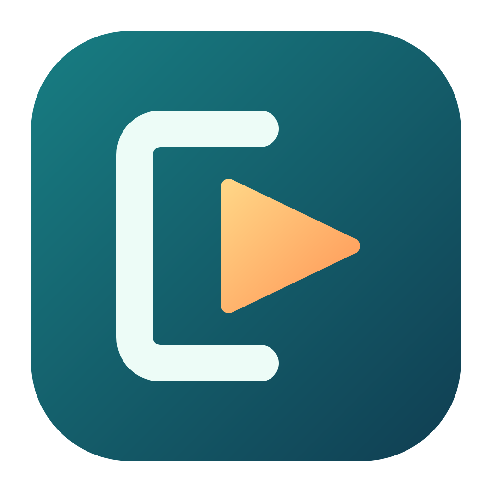
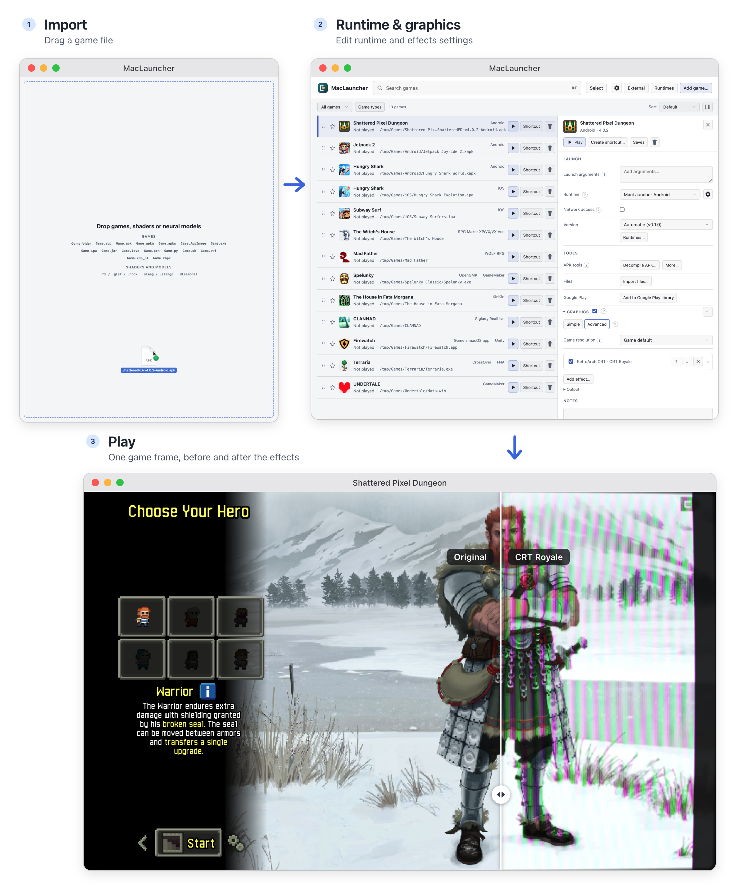

# MacLauncher

MacLauncher is a native runtime system, graphics/effects layer, and patch/tinker tool for playing games on macOS. tl;dr:
- [Native runtime system](#maclauncher-as-a-native-runtime-system): MacLauncher collects and automatically handles many different native macOS runtimes for a large variety of games. You can drag in some exe, it will automatically detect what engine and runtime versions should be best supported for it to run natively on macOS, and the runtime installation and management will be automatically handled for you. See the screenshot below for a small sample of what it can run natively (without [WINE](https://www.winehq.org/)/[CrossOver](https://www.codeweavers.com/crossover/)).
- [Graphics/effects layer](#maclauncher-as-a-graphics-and-effects-layer): MacLauncher includes a very powerful graphics subsystem, with neural upscaling, frame generation, [DLSS 5](https://github.com/iamwavecut/MLX-DLSS), and pretty much any custom shader you can import yourself, in any arbitrary combination (including ports of [Lossless Scaling](https://store.steampowered.com/app/993090/Lossless_Scaling/) and [ReShade](https://github.com/crosire/reshade) to macOS). All of this runs natively on [Metal](https://developer.apple.com/metal/) and across all runtimes.
- [Patch/tinker tool](#maclauncher-as-a-patchtinker-tool): MacLauncher lets you pick the version of everything (runtimes, graphics translators, and even the version and platform of games you download from storefronts), doesn't change your games or the apps it builds on except through managed patches you can undo, and gives you as much control as it can. This includes per-game DXVK, vkd3d-proton and Vulkan drivers inside CrossOver, Sikarugir and WineCX without patching any of them, our own build of [KosmicKrisp](docs/runtimes/KOSMICKRISP.md) with a lot of extra Vulkan features, Steam downloads of any platform or older version of a game, a Steam bridge so Windows games can use the Mac Steam client, a large selection of extractors/decompilers and cheat tools, etc.

The [website](https://procrastinine.github.io/maclauncher/) has an interactive demo of the launcher and longer explanations of everything here.



Shown: Android version of [Shattered Pixel Dungeon](https://github.com/00-Evan/shattered-pixel-dungeon) with [CRT Royale](https://github.com/akgunter/crt-royale-reshade) shaders.

## Running MacLauncher

The easiest way to run is through MacLauncher.app in the [Releases](https://github.com/procrastinine/maclauncher/releases). It is ad-hoc signed and you will need to allow it through Gatekeeper because I don't want to pay Apple $100 per year for a developer ID.

There are two separate apps, `MacLauncher.app.zip` for Apple Silicon and `MacLauncher-Intel.app.zip` for Intel Macs, and both share the same library, settings and runtimes. Either needs macOS 13 or later. Some runtimes and graphics features need Apple Silicon or a newer macOS (e.g. Android and Switch need Apple Silicon, and PS5 needs macOS 26), and MacLauncher just turns off what your Mac can't run; see [Macs and macOS versions](https://procrastinine.github.io/maclauncher/macs-and-macos/) for what works where.

How to do it: [Open Anyway in System Settings → Privacy & Security](https://support.apple.com/en-us/102445).

Now, it is perfectly fair to be skeptical about opening something you downloaded that asks you for this, so I specifically made MacLauncher binaries fully verifiable, i.e. you can [directly verify that the .app came directly from an exact version of the source code on GitHub, built using GitHub actions with no shady blobs from me](docs/development/VERIFYING.md) (and similarly for any other downloadable builds we provide in [MacLauncher Builds](https://github.com/procrastinine/maclauncher-builds)). You can then audit the exact source code to make sure it doesn't do anything you don't want, and while asking this would have been facetious before AI agents were a thing, it is now reasonable if you want to go through the extra step.

You can also run [from source](#development), and everything should be the same.

# MacLauncher as a native runtime system

https://github.com/user-attachments/assets/923b7374-076f-4b5d-aa5d-30dfb9f864bf

*Shown: The Penjikent Creature, a [Godot](https://godotengine.org/) game packaged for Windows, dragged in as its `.exe`. MacLauncher detects Godot 3.5.2, downloads the matching runtime after asking, and plays it natively, without WINE. The installed Godot versions are then managed in **Runtimes**.*

## Idea

A surprising number of games have runtimes that are available on macOS (and Linux) even though the games themselves are packaged for Windows and don't work out of the box. These games don't require WINE or emulation, and running natively can gain you higher performance and (sometimes) better compatibility. One of the purposes of MacLauncher is to configure these native runtimes automatically, with version management, so you can just drag in a game directory or exe and start playing with the maximally compatible version (or choose one yourself).

This launcher started by taking the patches in https://github.com/bakustarver/rpgmakermlinux-cicpoffs to macOS and wrapping it all in a UI, although I have added many more features since then. It has now gotten to the point where **a nontrivial proportion of indie games meant for Windows can just be dragged in and played without requiring WINE** (at least with the sampling bias of "indie games I personally thought of"), and similarly for iOS and Android. Still, compatibility is at the level of "try it" for many things, mainly depending on the specific runtime (for example, [Ren'Py](https://github.com/renpy/renpy) and [HTML5 RPGMaker](docs/game-types/RPGMAKER_MV_MZ.md) have basically perfect compatibility, but [Unity](https://unity.com/) is much more uneven).

## Why use a native runtime?

There are quite a few benefits to using native macOS runtimes for games, even when CrossOver compatibility is quite good and some developers distribute native mac builds.
- Games are generally more performant and efficient running under native runtimes compared to CrossOver/WINE.
- Compatibility is often better on native runtimes as well, although sometimes it goes the other way.
- Native runtimes have better OS integration (window management, mouse behavior, etc). I have had so much more "erratic" behavior (mouse movements not feeling right, windowed vs fullscreen mode issues or blocks, kind of corrupted sound, etc) on CrossOver, so in practice, if a game can launch in MacLauncher, I prefer to use it.
- Some .app deployments for indie games (e.g. [itch.io](https://itch.io/)) are broken because the developer just clicked "build for mac" and never test it, and the .app then runs into signing or packaging problems. This is perfectly avoidable and can be solved by just pointing a properly working runtime at its data.

This is similar in spirit to the many [decomp-recomp projects](https://github.com/SubmitGame/awesome-decomp-games) that can already be played via WINE or emulator but where people still benefit from a native runtime. Most decomp-recomp projects are ports of individual older console games, though, while MacLauncher covers qualitatively different games: indie games built on shared engines, mobile games, visual novels, and so on. MacLauncher doesn't provide these individual ports itself, as there are just so many of them (and it instead focuses on _shared_ runtimes), but it is fully compatible with them: download a port's macOS build through e.g. [Quiver Launcher](https://github.com/tgeorgiadis/quiver-launcher) and drag it into MacLauncher, where it runs like any other native Mac game. I am also considering adding some sort of "game store" for these individual games if creating scripts for a large number of them ever becomes personally tractable.

## Game support

MacLauncher supports many game types. Please see the [module inventory](docs/development/MODULES.md#modules-and-backends) for details. A summary:

- **macOS apps/scripts/binaries:** these are `.app`, `.sh`, Mach-O binaries, etc, that are already made for macOS. Why would you want to run these in MacLauncher? Well, outside of using MacLauncher as a game manager, there are several reasons:
  - MacLauncher provides an easy way to remove Apple quarantine (e.g. apps showing as "damaged") and allow execution for scripts and binaries.
  - You might want to run things through this interface due to the graphics layer, e.g. you want to use DLSS or a shader on a macOS native game.
  - Excitingly, you can run **32-bit macOS binaries** that were unsupported all the way back in Catalina! This is provided through the [mac32](https://github.com/Shagulka/mac32) runtime, and although compatibility is not perfect yet, it can run e.g. [Portal 2](https://store.steampowered.com/app/620/Portal_2/).
- **Windows games:** there are many!
  - **RPGMaker:** 2000/2003 through [EasyRPG Player](https://github.com/EasyRPG/Player), MV/MZ through [Electron](https://github.com/electron/electron) or [NW.js](https://github.com/nwjs/nw.js), XP/VX/VX Ace through [MKXP-Z](https://github.com/mkxp-z/mkxp-z).
  - **HTML games:** similarly to RPGMaker MV/MZ, most games based on web technologies will "just work", including [Construct](docs/game-types/CONSTRUCT.md), [TyranoBuilder](docs/game-types/TYRANO.md) and [GameMaker HTML5](https://github.com/YoYoGames/GameMaker-HTML5).
  - **Ren'Py**
  - **[Godot](https://github.com/godotengine/godot)** (note: version matching is very important here! e.g. Godot 4.5 and 4.6 are usually not cross-compatible! Luckily MacLauncher auto-detects the version of Godot a game was made with)
  - **[LÖVE](https://github.com/love2d/love)**
  - **[GameMaker](https://gamemaker.io/):** you can use the official GameMaker runtime, or alternatively, [Butterscotch](https://github.com/ButterscotchRunner/Butterscotch) for GameMaker Studio and [OpenGMK](https://github.com/OpenGMK/OpenGMK) for GameMaker classic (custom macOS port).
  - **Unity:** Mono games can usually run through the macOS Unity player and are supported in MacLauncher (similarly to Godot, version management is important, and MacLauncher does it for you). [Il2Cpp](https://docs.unity3d.com/Manual/IL2CPP.html) translates everything into system calls so you need WINE for that. Basically, some Unity games (the ones having little Windows-specific code) work, others do not.
  - **[XNA/FNA](docs/game-types/FNA.md):** with [FNA](https://github.com/FNA-XNA/FNA), [FNA3D](https://github.com/FNA-XNA/FNA3D), [FAudio](https://github.com/FNA-XNA/FAudio) and [.NET](https://github.com/dotnet/runtime).
  - **[WOLF RPG](docs/game-types/WOLFRPG.md):** with [Browser Woditor](https://frostyhowl.com/browser-woditor/).
  - **Flash (`.swf`):** via [Adobe Flash Projector](docs/game-types/FLASH.md#runtimes) or [Ruffle](https://github.com/ruffle-rs/ruffle)
  - **Java:** with [Temurin](https://github.com/adoptium/temurin-build) version management, [Vineflower](https://github.com/Vineflower/vineflower) decompilation, and [steamworks4j](https://github.com/code-disaster/steamworks4j).
  - **Infinity Engine:** [GemRB](https://github.com/gemrb/gemrb).
  - **Adventure games:** with [ScummVM](https://github.com/scummvm/scummvm).
  - **MUGEN:** [Ikemen GO](https://github.com/ikemen-engine/Ikemen-GO).
  - **[Haxe](https://haxe.org/):** [HashLink](https://github.com/HaxeFoundation/hashlink).
  - **DOS games:** through [DOSBox Staging](https://www.dosbox-staging.org/), including DOS `.exe`, `.com`. This one _is_ emulation which is "fine" because the resource needs are so low. If a DOS game is actually a Doom-engine, Build-engine or DREAMM game (i.e. its folder has the main game file), the matching engine below is offered as a runtime for it too.
  - **Doom-engine and Build-engine games:** [UZDoom](https://github.com/UZDoom/UZDoom) for Doom-engine games (Doom, Heretic, Hexen, Strife, Chex Quest, Freedoom...) and [Raze](https://github.com/ZDoom/Raze) for Build-engine games (Duke Nukem 3D, Blood, Shadow Warrior, Redneck Rampage, PowerSlave...). These are source ports, so they run as native macOS apps and read your original game data in place: just drag in the [IWAD](docs/game-types/DOOM_ENGINE.md) or [GRP](docs/game-types/BUILD_ENGINE.md) file, or the folder it's in. Their config and saves stay with the game in MacLauncher's data instead of the engine's global folders.
  - **LucasArts games:** with [DREAMM](https://dreamm.aarongiles.com/), Aaron Giles' emulator for LucasArts games, for the titles ScummVM doesn't cover (Star Wars: Dark Forces, Outlaws, and the Desktop Adventures games). See the [DREAMM guide](docs/game-types/DREAMM.md).
  - **Visual novels**: there are a lot. Surprisingly many VN engines get cross-platform runtimes. Here is what MacLauncher currently supports:
    - **NScripter:** [Onscripter-Yuri](https://github.com/YuriSizuku/OnscripterYuri), and a custom macOS port of [ONScripter-EN](https://github.com/Galladite27/ONScripter-EN).
    - **KiriKiri / KAG:** [krkrsdl2](https://github.com/krkrsdl2/krkrsdl2) and [KAG3](https://github.com/krkrsdl2/kag3).
    - **MAGES:** [Impacto](https://github.com/CommitteeOfZero/impacto)
    - **AI5WIN:** [AI5-SDL2](https://github.com/nunuhara/ai5-sdl2).
    - **AliceSoft:** [System3](https://github.com/kichikuou/system3-sdl2), [xsystem35](https://github.com/kichikuou/xsystem35-sdl2), and [xsystem4](https://github.com/nunuhara/xsystem4).
    - **Siglus / RealLive:** [siglus_rs](https://github.com/xmoezzz/siglus_rs) and [RLVM](https://github.com/eglaysher/rlvm) (RealLive-only for the latter).
    - **Nitroplus:** [NPengine](https://github.com/FGRE/libnpengine) and [libnpa](https://github.com/FGRE/libnpa).
    - **Minori:** [ReMinori](https://github.com/luoyily/ReMinori).
    - **FAVORITE / FVP:** [RFVP](https://github.com/xmoezzz/rfvp)
    - **VNDS:** [VNDS-LOVE](https://github.com/ajusa/VNDS-LOVE).
  - **Other Windows executables:** you can provide a local CrossOver application to run any Windows executable, and you can manage multiple versions of it. Or alternatively if you don't have CrossOver, MacLauncher can also manage the free [Sikarugir](https://github.com/Sikarugir-App/Sikarugir) for you, which is largely the same thing (WINE with graphics translation layers). There's also a third option, [WineCX](https://github.com/dappermint/winecx-gptk), which is free as well and also managed for you: it's CodeWeavers' CrossOver WINE changes rebased onto a current WINE release, so Apple's D3DMetal can load into it like it does in CrossOver (it ships with DXMT, DXVK for 32-bit games, MoltenVK and GStreamer, and you can add a D3DMetal version from Runtimes). Current WineCX releases need macOS 26, which MacLauncher reads from the download before installing it. WineCX versions only come from those managed downloads, since every launch is checked against the files MacLauncher recorded when it installed them, so there's no registering your own WineCX folder. All three run on one shared WINE layer in MacLauncher, so settings, translators, private bottles, effects, DLSS routing and the Steam bridge work the same way whichever one a game uses. There are some convenient options built in, such as easy options to set the locale and a workaround for [BepinEx](https://github.com/BepInEx/BepInEx) to work, as well as the standard graphics options and WINE flags. See the [Wine runtimes guide](docs/runtimes/WINE.md) and the [CrossOver](docs/runtimes/CROSSOVER.md), [Sikarugir](docs/runtimes/SIKARUGIR.md) and [WineCX](docs/runtimes/WINECX.md) guides for details.

    The WINE setup is an important part of MacLauncher, and we do a lot more than just wrap CrossOver, Sikarugir and WineCX. By default, if no existing bottle is specified, we create a "private" bottle for every game so you can play it with any version of CrossOver, Sikarugir or WineCX, including after updates. Alternatively, if you already have a game set up in a CrossOver bottle or a Sikarugir wrapper, you can also just point MacLauncher at it and it works like CrossOver normally does.

    Sikarugir and WineCX games also start from a little app bundle that macOS sees as a game, so macOS Game Mode kicks in when you play them full screen. Because of that bundle, macOS 15 and later asks once per runtime (once for Sikarugir, once for WineCX) whether those games can use the local network, with a message that names the runtime. Your answer covers every game and version of that runtime, you can change it in Privacy & Security → Local Network, and Play never waits on the question. The per-game Network access checkbox still applies on top of it.

    Graphics are also carefully handled on WINE. On top of the whole graphics layer working on WINE games like it does everywhere else, it can also use the DLSS data (e.g. nvngx.dll) in Windows games running through WINE, and either route DLSS and XeSS calls to MetalFX, or pass the camera data to MacLauncher's graphics pipeline where it can be used with any of the temporal upscaling and frame generation effects. When D3DMetal handles a game's DLSS on a WINE that supports it (like WineCX), the game is also shown an NVIDIA GeForce RTX 4090 as its GPU, so it actually offers its DLSS option, and D3DMetal then does the upscaling with MetalFX. Games that ship AMD's FidelityFX API library (for Vulkan or Direct3D 12) can also have their FSR upscaling done by MacLauncher's selected upscaler instead, in CrossOver, Sikarugir and WineCX alike. Turn the game's graphics off and the game's own FSR takes over again, live.

    The other big thing I added is control over graphics translators. Similar to tools like [CXPatcher](https://github.com/italomandara/CXPatcher), MacLauncher lets you patch in custom versions of translators ([DXMT](https://github.com/3Shain/dxmt), D3DMetal, [DXVK](https://github.com/doitsujin/dxvk) including D9VK and the async builds, [vkd3d-proton](https://github.com/HansKristian-Work/vkd3d-proton) or WineD3D, plus Vulkan drivers like [MoltenVK](https://github.com/KhronosGroup/MoltenVK) and [KosmicKrisp](https://docs.mesa3d.org/drivers/kosmickrisp.html)), but unlike those, MacLauncher does not copy or patch CrossOver.app, and keeps everything in MacLauncher data (so you don't have multiple versions of CrossOver and duplicated storage, and also works across updates). Again, this is individual and customizable for each game. See [Windows games and WINE](https://procrastinine.github.io/maclauncher/windows/) on the website for the full explanation, and the [translator guide](docs/runtimes/TRANSLATORS.md) for the details.
- **Mobile games:** we have runtimes that run things natively (like WINE), not through emulation!
  - **iOS / iPadOS:** through [PlayCover](https://github.com/PlayCover/PlayCover), or more specifically [PlayTools](https://github.com/PlayCover/PlayTools)
  - **Android, or ARM64 VR/XR:** MacLauncher offers the [Mac.apk](https://github.com/kksimp/Mac.apk) and [AIM](https://github.com/hahnlee/aim) runtimes, both of which can play `.apk` on mac (Mac.apk through what is basically Java, AIM through Android's own ART runtime). In addition, MacLauncher itself offers the [MacLauncher-Android](https://github.com/procrastinine/maclauncher-android) runtime which is specifically for games and (in my testing) more compatible with complex commercial games (think [Roblox](https://www.roblox.com/) or [Hungry Shark Evolution](https://www.ubisoft.com/en-us/game/hungry-shark/evolution) or the like), plus compatible with VR/XR (e.g. [Beat Saber](https://www.beatsaber.com/)) due to being built on [Klepton](https://github.com/shinyquagsire23/Klepton).
- **Game consoles:** again, native, not emulated
  - **PlayStation 5:** through [AnyPS5](https://github.com/boykopovar/AnyPS5), which converts PS5 executables into Intel macOS binaries that run natively on Intel Macs and through [Rosetta](https://support.apple.com/en-us/102527) on Apple Silicon. MacLauncher handles conversion, runtime versions, [the Vulkan driver](docs/game-types/PS5.md), and keyboard/mouse/controller settings. The converted game runs as its own little Mac app, with the game's name and icon in the Dock. This requires unpacked, decrypted game files and macOS 26+. There is also an optional [Prosper](https://github.com/mattias800/prosper) backend. See the [PS5](docs/game-types/PS5.md) and [Prosper](docs/game-types/PS5.md#prosper) guides for details.
  - **Nintendo Switch and Switch 2:** through [nxnative](https://github.com/seedds/nxnative), running ARM64 game code on Apple Silicon with Metal graphics. You can import `.nsp`, `.nsz`, `.xci` or `.xcz` games, decrypted dumps, or `.nup` files, and MacLauncher handles extraction, preparation, runtime versions, game update versions and shader compilation. Decrypted dumps and `.nup` files play without keys or firmware, and Switch 2 games get labeled as Switch 2 once nxnative has prepared them. Encrypted games need your own `prod.keys`. See the [Switch guide](docs/game-types/SWITCH.md) for details.
- **Videos:** it is kind of funny but you can play videos through MacLauncher via [mpv](https://github.com/mpv-player/mpv), which is useful due to the whole graphics layer meaning we can upscale and apply effects on videos as well as games. MacLauncher supports mpv plugins (by default, [uosc](https://github.com/tomasklaen/uosc) and [thumbfast](https://github.com/po5/thumbfast)) but you can add any yourself, and also supports playlists in folders, saved watch positions, and subtitles. You can also preview and export videos with effects applied; see the [video guide](docs/game-types/VIDEO.md). A note: we actually recommend our custom build of mpv in MacLauncher Builds so that frame generation actually takes the video's frames...

Missing runtimes can be downloaded when you press Play, after asking for permission, and then the game preparation and launch continue automatically. Installed versions stay available offline, and you can keep different versions for different games. If the default version you saved in Runtimes isn't installed but a compatible one is, Play just uses the installed one instead of asking to download (a version you pick for a specific game stays exact).

If a game lives on an external drive that is unplugged, or you move or rename its folder, the game just shows as Unavailable and nothing it has stored is touched. Plug the drive back in and it comes back, or use [Locate…](docs/library/GAME_PREPARATION.md#locating-moved-files) to point it at the new location while keeping its saves, settings and effects. MacLauncher remembers which games were unavailable, so they already show that way when the library opens at startup.

The launcher answers clicks right away and lets the slower work fill in afterwards. Game icons are there in the first paint of the library, since MacLauncher keeps the small previews it made last time, and local artwork in External shows up with its row. Pressing Play shows the game as starting immediately, even when a sleeping drive takes a few seconds to answer, and Cancel works from that moment. Switching a game's runtime shows up instantly too, while MacLauncher works out in the background where that runtime keeps the saves (if it can't, a note under Play tells you why). Hiding the cheat overlay's Tools button works the same way: the setting changes at once, and if patching the game to match fails, it goes back. Each game also gets one runtime settings window per runtime, so clicking the gear again just brings that window to the front. Settings, Runtimes and Credits open without a loading pause as well, since MacLauncher keeps one of those windows drawn and ready in the background, and if you open several of them at once, each extra window shows up right away and fills in its contents as they load.

## Unique features

Most of the above runtimes are existing tools with MacLauncher managing them. However, there is also a significant amount of functionality and compatibility that you can't find anywhere else. Here are some highlights:
- The previously mentioned macOS runtime for Android and VR/XR games (see MacLauncher-Android).
- A port of [OpenGMK to macOS](docs/game-types/GAMEMAKER.md#classic-opengmk): involving [AppKit](https://developer.apple.com/documentation/appkit) input/windows, [OpenGL](https://www.khronos.org/opengl/), [CoreAudio](https://developer.apple.com/documentation/coreaudio) and original-read/private-write handling. As far as I know, this is the only way to get GameMaker classic games running natively on mac.
- Similarly, a [macOS port of AnyPS5](docs/game-types/PS5.md).
- Also, custom macOS ports of [ONScripter-EN](docs/game-types/NSCRIPTER.md), [AI5](docs/game-types/AI5.md), [KAG3](docs/game-types/KIRIKIRI.md), and [ReMinori](docs/game-types/MINORI.md).
- Automatic [offline Steam API support](docs/runtimes/STEAM_API.md) (for things needing Steam API before play).
- [MacLauncher KosmicKrisp](src/modules/shared/vulkan/README.md), our own build of KosmicKrisp that adds the Vulkan features upstream is missing (transform feedback, wireframe/point fill, single-texel buffer alignment and variable multisample rate), implemented on Metal rather than stubbed. This lets ANGLE do OpenGL ES 3.2 for Android games, and lets DXVK and vkd3d-proton (the translators behind Proton on Linux) run on KosmicKrisp in CrossOver, Sikarugir and WineCX, so Direct3D 12 games can run through vkd3d-proton at feature level 12_1 (12_2 in conformance mode).

# MacLauncher as a graphics and effects layer

https://github.com/user-attachments/assets/5a99ddfb-b73c-4cb6-b037-1640686f7fe4

*Shown: the DOOM 3 demo running natively through [dhewm3](https://github.com/dhewm/dhewm3). First a CRT filter and grayscale in the Simple view, with the split and difference views, then the DLSS chain described below, in the Advanced view: downsample to 540p, DLSS 5, MetalFX back up to the window, and Lossless Scaling frame generation at 4x. The performance overlay shows the ~15fps coming out of DLSS turning into 60fps on screen, and DLSS and frame generation are switched off and on again live.*

Maybe _the_ most useful thing about MacLauncher is that it provides a very powerful graphics postprocessing system where you can control _exactly what_ graphics/effects you apply, with very broad support. All of these effects run on native Metal, **not** WINE, and work across **any** runtime you want to use inside MacLauncher. i.e., you could literally drag Microsoft Word into MacLauncher and apply GFX to it lmao. Here is what's included:
- **Upscaling:**
  - **Spatial:** [MetalFX Spatial](https://developer.apple.com/documentation/metalfx), [AMD FSR 1](https://github.com/GPUOpen-Effects/FidelityFX-FSR), [Lossless Scaling LS1](docs/graphics/README.md#lossless-scaling-setup) (you have to provide your own copy of Lossless Scaling), plus traditional upscaling algorithms, [libplacebo filters](docs/graphics/PROVIDERS.md#spatial-resizing) and [Mako](https://github.com/eugeniosegala/MAKO).
  - **Temporal:** [MetalFX Temporal](https://developer.apple.com/documentation/metalfx) (including [its denoised version](https://developer.apple.com/documentation/metalfx/mtlfxtemporaldenoisedscaler)), AMD [FSR 2.2](https://github.com/GPUOpen-Effects/FidelityFX-FSR2)/[3.1/4.1](https://github.com/GPUOpen-LibrariesAndSDKs/FidelityFX-SDK), [Arm ASR](https://github.com/arm/accuracy-super-resolution-generic-library), [Snapdragon GSR 2](https://github.com/SnapdragonGameStudios/snapdragon-gsr), [Intel XeSS](https://github.com/intel/xess) and [DLSS SR](https://github.com/iamwavecut/MLX-DLSS). [FSR 4](https://github.com/UzenUPoZiTiV4ik/fsr4-native-macos) includes [Exact Fast, Lite and Lite2 profiles](docs/graphics/PROVIDERS.md#scene-temporal-upscaling). DLSS SR has separate image-history and scene-input models.
  - **Neural:** [RTX Video Super Resolution](https://github.com/iamwavecut/MLX-DLSS), [Real-ESRGAN](https://github.com/xinntao/Real-ESRGAN) (4x) and [Real-CUGAN](https://github.com/bilibili/ailab/tree/main/Real-CUGAN) (2x/3x/4x).
  - **Shader upscalers:** whatever mpv shaders you want to provide (e.g. CNN or [Anime4k](https://github.com/bloc97/Anime4K) upscalers). Downloadable shader collections include [ArtCNN](https://github.com/Artoriuz/ArtCNN), [CuNNy](https://github.com/funnyplanter/CuNNy), [ACNet/ARNet](https://github.com/TianZerL/ACNetGLSL), [FSRCNNX](https://github.com/iwalton3/default-shader-pack), [RAVU](https://github.com/bjin/mpv-prescalers) and [NNEDI3](https://github.com/bjin/mpv-prescalers), as well as pixel-art scalers like [xBRZ](https://github.com/libretro/slang-shaders/tree/master/edge-smoothing/xbrz) and [SABR](https://github.com/libretro/slang-shaders/tree/master/edge-smoothing/sabr).
- **Frame generation:** [Lossless Scaling LSFG](docs/graphics/README.md#lossless-scaling-setup), [MetalFX](https://developer.apple.com/documentation/metalfx), [FSR 3](https://github.com/GPUOpen-LibrariesAndSDKs/FidelityFX-SDK), Intel XeSS, [MLX interpolation](https://github.com/iamwavecut/MLX-DLSS) and [RIFE](https://github.com/hzwer/Practical-RIFE). [LSFG](docs/graphics/README.md#frame-generation), MLX interpolation and RIFE work from consecutive images, so they don't need the game's depth or motion vectors. Frame generation adds displayed frames, without speeding up the game simulation.
- **Neural reconstruction and restoration:**
  - **Reconstruction:** DLSS 5, via MLX-DLSS.
  - **Restoration:** [NAFNet](https://github.com/megvii-research/NAFNet) denoising/deblurring cleans up the image at its existing resolution. See the [restoration guide](docs/graphics/NEURAL_RESTORATION.md).
  - **Models:** you can [download supported models](docs/graphics/README.md#neural-models) or [import your own compatible model packages](docs/graphics/README.md#neural-models), and choose different models for different steps in the pipeline.
- **Shaders and effects:** any shader you provide in ReShade, [RetroArch Slang](https://github.com/libretro/slang-shaders), and mpv/[libplacebo](https://code.videolan.org/videolan/libplacebo), plus [MagpieFX](https://github.com/Blinue/Magpie) and [ISF](https://github.com/Vidvox/ISF-Files), including setting any shader parameters. For those unfamiliar, these include things like CRT effects, depth effects, color postprocessing, etc. A sample of the effects included with MacLauncher, which can be supplemented with whatever you choose:
  - **Image effects:** CRT Royale and other CRT shaders, [SMAA](https://github.com/iryoku/smaa)/[CMAA2](https://github.com/GameTechDev/CMAA2) antialiasing, [bloom](https://github.com/martymcmodding/qUINT), [sharpening](https://github.com/CeeJayDK/SweetFX), [debanding](https://github.com/martymcmodding/qUINT), [color grading/LUTs](https://github.com/prod80/prod80-ReShade-Repository), [histogram auto exposure](docs/graphics/PROVIDERS.md#shader-formats-and-image-effects), [film grain](https://github.com/GPUOpen-LibrariesAndSDKs/FidelityFX-SDK), [lens effects](https://github.com/GPUOpen-LibrariesAndSDKs/FidelityFX-SDK), [Gaussian blur](https://github.com/GPUOpen-LibrariesAndSDKs/FidelityFX-SDK), [anisotropic Kuwahara](https://github.com/jkyprian/gpuakf) (the painterly effect), [local Laplacian](https://github.com/halide/Halide/blob/d62903bbf5166e05841e1346837c8367e2296a83/apps/local_laplacian/local_laplacian_generator.cpp) detail/contrast, and [colorblindness correction](src/modules/shared/reshade/shader-collection/accessibility/daltonize.fx).
  - **Depth/lighting effects:** [XeGTAO](https://github.com/GameTechDev/XeGTAO) and [AMD CACAO](https://github.com/GPUOpen-LibrariesAndSDKs/FidelityFX-SDK) ambient occlusion, [FidelityFX depth of field](https://github.com/GPUOpen-LibrariesAndSDKs/FidelityFX-SDK), [screen-space reflections](docs/graphics/PROVIDERS.md#shader-formats-and-image-effects), [visibility-bitmask indirect lighting](https://github.com/cdrinmatane/SSRT3), [depth fog and outlines](docs/graphics/PROVIDERS.md#shader-formats-and-image-effects). These use actual scene depth/camera data, plus normals/material/lighting data where needed. There is also image-based fog using [Depth Anything V2](https://github.com/DepthAnything/Depth-Anything-V2), for when you only have the final image.
  - **Shader collections:** included and downloadable collections cover [qUINT](https://github.com/martymcmodding/qUINT), [CShade](https://github.com/papadanku/CShade), [prod80](https://github.com/prod80/prod80-ReShade-Repository), [FXShaders](https://github.com/luluco250/FXShaders) and [NiceGuy shaders](https://github.com/mj-ehsan/NiceGuy-Shaders).
- **Output controls:** [tone mapping](docs/graphics/README.md#generation-and-output) (Automatic, None, Reinhard or PBR Neutral), [HDR/wide-gamut color handling](docs/graphics/FRAME_API.md#color-alpha-and-time-domains), [frame pacing](docs/graphics/README.md#generation-and-output), [black-frame insertion](docs/graphics/README.md#generation-and-output) and [CRT beam scheduling](docs/graphics/README.md#generation-and-output). There is also a live [source/processed split and difference view](docs/graphics/README.md#generation-and-output), so you can see what your effects are actually doing.
- **Performance overlay, frame-rate cap and screenshots:** an [FPS/performance overlay](docs/graphics/README.md#performance-overlay-frame-rate-cap-and-presentation) (Compact or Detailed: frame rates, GPU time, latency, pacing, memory, generated/dropped frame counters and per-step GPU time), a frame-rate cap from 10 to 1000 fps, display sync and drawable-count controls for latency vs. smoothness, and [global shortcuts](docs/graphics/README.md#shortcuts-and-screenshots) to bypass effects or save a screenshot (without the overlay) from any app. The screenshot has your effects on it, or is just the game's own picture when graphics are off.
- **Live switching:** for all of these, we can live switch what effects we apply, in both windowed and fullscreen modes (or switching in between the two), without restarting the game.
- **Other apps' windows and displays:** the same graphics chain can run on any other app's window, or on a whole display (macOS 15.2 or later), each with its own settings. See [Window](docs/game-types/WINDOW.md).

The UI has **[Simple](docs/graphics/README.md#the-graphics-chain)** and **[Advanced](docs/graphics/README.md#the-graphics-chain)** views of the same pipeline. Simple gives you dropdowns for image filters, resizing and temporal effects; Advanced lets you add and reorder individual steps. Switching between them keeps your settings. You can save a whole chain as a [preset](docs/graphics/README.md#the-graphics-chain) and apply it to other games, or turn Graphics off while keeping everything for later. [Shader collections](docs/graphics/README.md#shader-library), model downloads/imports and default choices are managed in [Runtimes → Graphics](docs/graphics/README.md).

[Processing sizes](docs/graphics/README.md#rendering-processing-and-output-size) are also configurable at each step: a fraction of the previous image, a fraction of the window/fullscreen size, or a fixed width/height (e.g. 540p). The window can stay the same size while the effects run at a different resolution. [Game render resolution](docs/graphics/FRAME_API.md#game-render-allocation-and-processing-extent) is a separate control, so downsampling an already rendered image reduces the work for the effects that follow it, without making the game itself render faster. A Downsample step can also use [adaptive quality](docs/graphics/README.md#adaptive-quality), which adjusts its working size within your chosen bounds to stay inside a GPU time budget.

Furthermore, the powerful part of MacLauncher is that it not only is able to apply these effects, but is able to apply them in **any order, and any combination.** Take the following use case, for example:
- We want to use DLSS 5 to see what games can look like when we try to make them "realistic".
- However, DLSS 5 is slow as hell, especially on my wimpy MacBook from the M2 generation with no neural accelerators. It is completely unplayable if we just try to apply it.
- Thus, we can apply a pipeline: first, render or downsample the game at ~540p, run DLSS 5 on 540p, then upsample (e.g. using MetalFX) to your actual screen resolution (e.g. 4k), which can all be handled through stacking effects in MacLauncher.
- It turns out that my wimpy MacBook struggles even like this, hitting an abysmal 15fps or so even DLSS-ing at 540p, so "real time" but not pleasant. Therefore, you can _then_ apply Lossless Scaling frame generation, say 4x, yielding 60fps. I tried it, and yes it is "smooth". Now, would I want to play competitive games with this? Hell no, the input latency is crap, frame generation isn't perfect, and upscaling ultimately makes the image lose detail (although it is often pretty good). But is it _fun_ to mess with DLSS and be able to play the game? In my opinion, absolutely.
- If you additionally want to change the colors or make it look like it came out of a CRT, you can play with whatever shaders you want on top of that.
- And notice in this process what you can do:
  - Change any parameters you want (e.g. DLSS strength, how much to upscale, shader parameters) in any step of the process
  - Change the pipeline in any way while looking at the game window, live, for the change in effects, without having to go out of the game or restart
  - And this applies for all games! Whatever macOS `.app`, something running on CrossOver, a browser game, [Android/iOS](docs/graphics/PIPELINE.md), visual novels, whatever you want!

## Unique features

A lot of these graphics features are custom ports to macOS that are again found nowhere else and are unique to MacLauncher. For example:
- The [graphics layer](docs/graphics/PIPELINE.md) itself: custom macOS ports of Lossless Scaling and ReShade, with neural models, shaders, upscaling and frame generation all in one pipeline. The interesting part is being able to combine all of these, in whatever order you want, across the different runtimes, and change them live while looking at the game.
  - [Lossless Scaling macOS port](docs/graphics/README.md#lossless-scaling-setup)
  - [ReShade macOS port](src/modules/shared/reshade/native/README.md)
- Native Metal ports of [AMD FSR 1/2/3/4](docs/graphics/PROVIDERS.md), Arm ASR and Snapdragon GSR 2, using the same graphics layer. These include temporal upscaling and FSR 3 frame generation, with the game's actual depth/motion inputs.
- [MLX neural processing for Intel games too](docs/graphics/PROVIDERS.md#neural-rendering-restoration-and-image-upscaling): the game can be running under Rosetta or CrossOver while an Apple Silicon helper runs the neural models on the GPU.

Some other graphics implementations/adaptations in MacLauncher:

- RIFE 4.6 frame interpolation, adapted to run through [MLX](https://github.com/ml-explore/mlx)/Metal in the same pipeline as everything else.
- Real-ESRGAN and NAFNet upscaling/restoration, building on existing [Real-ESRGAN MLX](https://github.com/xocialize/mlx-realesrgan-swift) and [NAFNet MLX](https://github.com/xocialize/mlx-nafnet-swift) ports and adapted into the shared [model runtime and live graphics pipeline](docs/graphics/NEURAL_RESTORATION.md).
- A Real-CUGAN implementation on MLX/Metal, using its original 2x/3x/4x models.
- Depth Anything V2 Small on MLX/Metal, used for [image-based depth fog](docs/graphics/PROVIDERS.md#shader-formats-and-image-effects).
- Native Metal ports of CMAA2 antialiasing, XeGTAO ambient occlusion, and AMD CACAO, FidelityFX depth of field, Lens and Blur.
- GPU adaptations of anisotropic Kuwahara (the painterly effect) and Halide's local Laplacian filter (detail/contrast).
- [Godot's screen-space reflections](https://github.com/godotengine/godot), SSRT3 indirect lighting, and [FXShaders depth fog/outlines](https://github.com/luluco250/FXShaders), adapted into the shared graphics layer.
- MagpieFX shader translation and execution on Metal, so its image filters and upscalers can be used alongside the other effects.

# MacLauncher as a patch/tinker tool

I've tried to be principled in my development of MacLauncher and the features I put into it, and I think most of my decisions come down to the following three "principles":
- **Version management.** You can pick the exact version of everything as is possible at all. For example, every runtime, every graphics translator and Vulkan driver, and the version and platform of the games you download from storefronts, they all have version management and you can always choose from a catalog or provide your own local files (MacLauncher picks a sensible default but you can always override it).
- **Unchanged source (non-destructive).** When possible, MacLauncher is **non-destructive**: it doesn't change the things it runs. For games, this means that MacLauncher will almost always shy away from changing the actual game files you provide to it (except when some game types like RPGMaker _do_ need changes to the game directory for saves, cheats, or mods, and even then, MacLauncher changes are fully tracked and reversible). In general, you can play something with MacLauncher, and then play it outside of MacLauncher, and MacLauncher should be compatible with that. This principle also applies to runtimes. For example, it doesn't modify CrossOver while still achieving the runtime swaps [CXPatcher](https://github.com/italomandara/CXPatcher) can, nor does it modify Steam like [NotProton](https://github.com/NotProtonNot/NotProton) does. This means that you don't need separate patched copies of either, and their updates usually don't break anything.
- **As much power to the user as possible.** Whenever it's possible, I include everything I can: every decompiler and cheat tool I could find for each game type, every setting a runtime offers (including launch flags), environment variables for every translator (as defaults and per game), and so on. Everything stays in your own files, nothing goes over the network unless you asked for it, and there are no user hostile anti-features, nor will there ever be.

## Runtime patching

Patching runtimes using custom translators (e.g. newer versions of GPTK or Vulkan translators) can offer many benefits for software like CrossOver, and is the reason CXPatcher is a popular project. MacLauncher does this as well, giving the user as much power as we can while making workflows as easy as we can as well, and following the principles above.

### Graphics translators in CrossOver, Sikarugir and WineCX

MacLauncher lets you manage graphics translation layers like DXVK, vkd3d-proton, D3DMetal, DXMT, MoltenVK or KosmicKrisp in existing CrossOver, Sikarugir or WineCX installations. Once again, this is similar to what CXPatcher does, but:
- with any translator version you want, from the upstream catalogs, our own builds, or builds you register yourself
- per game, so one game can use one DXVK version and another game a different one
- without changing CrossOver itself, so you don't need multiple copies of CrossOver, a CrossOver update doesn't undo anything, and the same translators work in Sikarugir and WineCX too

Each translator's options (e.g. the DXVK HUD or the Metal HUD) can be set per game, plus whatever environment variables you want. You can see exactly which translator, version and CPU build a game uses (e.g. x64 under Rosetta, or ARM64 for CrossOver's ARM builds) in the inspector: [TRANSLATORS.md](docs/runtimes/TRANSLATORS.md) lists every option. Runtimes also shows what each installed WINE comes with, read from its own files (e.g. "Includes DXMT 0.80 · DXVK 1.10.3 for 32-bit games · MoltenVK 1.4.2 · GStreamer 1.26.3" for WineCX), and the macOS version each translator needs is read from its binaries too, so a translator that can't load on your Mac falls back instead of breaking the game.

### KosmicKrisp

MacLauncher leans heavily on [KosmicKrisp](https://docs.mesa3d.org/drivers/kosmickrisp.html), the modern Vulkan driver for Macs, and uses it by default in several places: AnyPS5, Prosper, and Sikarugir, whose automatic Vulkan choice for Windows games is the KosmicKrisp in its own Template. For Windows games in CrossOver, Sikarugir or WineCX, our own KosmicKrisp build comes in when you pick it as a game's Vulkan driver, or automatically when you pick our DXVK or vkd3d-proton from Runtimes; you can pick it for Android games too (or still pick MoltenVK anywhere if you want). Compared to MoltenVK, the historical standard, KosmicKrisp is more "modern" in that it is a part of the standard [Mesa](https://mesa3d.org/) graphics library, using all of its machinery and is shipped by LunarG officially; furthermore, it is built on Metal 4 (Apple Silicon only, with no Intel compatibility baggage). In terms of functionality, KosmicKrisp is actually fully conformant to Vulkan 1.4 on Apple Silicon, while MoltenVK is only a subset; and MoltenVK is officially deprecated in favor of KosmicKrisp.

Surprisingly (to me), almost no mac gaming libraries currently use KosmicKrisp instead of MoltenVK. My best guess for why this is is just "history", i.e. because so many things (like CrossOver) have historically been built around the features MoltenVK does and does not have and patched their way around it, and KosmicKrisp is currently "less good" to directly slot in for the libraries that have expected MoltenVK for years.

To bridge this gap, we ship our own, heavily modified build of KosmicKrisp, which takes the already-Vulkan-1.4-compliant base and implements support for many optional Vulkan features that upstream does not have, focusing on what DXVK and vkd3d-proton need to run Direct3D games properly. For example:
- transform feedback with geometry streams, mesh shaders, and geometry and tessellation shaders together with multiview
- pixel and sample interlock (rasterizer-ordered views)
- conservative rasterization, depth bias control, wireframe fill, and wide or stippled lines
- sparse (tiled) resources where Metal supports them, plus descriptor heaps and device-generated commands
- 64-bit floating point in shaders, done in software
- Metal shader caches

[KOSMICKRISP.md](docs/runtimes/KOSMICKRISP.md) has the full list and table of features. tl;dr: Direct3D 12 games run through vkd3d-proton on our KosmicKrisp, in CrossOver, Sikarugir and WineCX, at Direct3D feature level 12_2 (the highest level, with ray tracing, mesh shaders and variable rate shading) and shader model 6.9 in conformance mode, and at feature level 12_1 and shader model 6.8 in the default performance mode (both modes are described below). vkd3d-proton is the Direct3D 12 translator from Valve's [Proton](https://github.com/ValveSoftware/Proton), the one that runs Direct3D 12 games on Linux and the Steam Deck, so picking it for a game puts that game on the same Direct3D 12 path Proton uses. On upstream KosmicKrisp or MoltenVK, vkd3d-proton doesn't even start. We also achieve ANGLE GLES 3.2 compliance (the highest level).

The same goes for DXVK, Proton's translator for Direct3D 8 to 11. Current versions of DXVK and vkd3d-proton both need Vulkan features that MoltenVK and upstream KosmicKrisp don't have, so if you pick either one from Runtimes for a game in CrossOver, Sikarugir or WineCX, MacLauncher pairs it with our KosmicKrisp as the Vulkan driver, and the game basically goes through Proton's graphics path (with KosmicKrisp turning the Vulkan into Metal at the end) instead of D3DMetal or DXMT. It's your choice, per game, and the Wine underneath is still CrossOver's, Sikarugir's or WineCX's, not Proton's.

#### Apple GPU support

KosmicKrisp is built on Metal 4, so it needs macOS 26 and an Apple GPU from the Apple7 family or later, which covers every M-series Mac. Apple groups its GPUs into families, and newer families can do natively some things that older ones have to emulate:

| GPU family | Mac chips |
| ---------- | --------- |
| Apple7     | M1        |
| Apple8     | M2        |
| Apple9     | M3, M4    |
| Apple10    | M5        |
| Apple11    | M6        |

Our version of KosmicKrisp can detect what GPU family your mac has, automatically enable the fast features, and apply the performance profile that is best for it (while also keeping the option to enable other features as overrides or a full "conformance mode" that is slower but has all features we provide). Some examples: on M5 and later, sampler LOD bias and min/max sampler filtering go straight to Metal, while older chips do them in the shader, and textures can be up to 32768 pixels instead of 16384. Specifically, the modes are:
- **Performance** (the default) turns on every emulation that is fast enough on your chip, which is most of them (33 of 43 on every Mac, including mesh shaders). Denormal handling, for example, stays on, because without it vkd3d-proton drops from shader model 6.2 and up to 6.1. What stays off is ray tracing (it's software traversal, no Metal ray tracing), variable rate shading (vkd3d-proton would put every pixel shader on the slower path), software 64-bit floats and a few rarely used things, plus depth bounds tests on M1 to M4 (M5 and later do them natively). That's why performance mode tops out at feature level 12_1 and shader model 6.8.
- **Conformance** turns every emulated feature on, which is what gets you feature level 12_2 and shader model 6.9 (ray tracing included).

The `KK_EMULATION` environment variable sets the mode and individual switches, per game like any other environment variable: `KK_EMULATION=conformance` turns everything on, and `KK_EMULATION=performance,-denorm_preserve` keeps the performance defaults but turns one feature off. Chip presets turn on every switch that a given generation runs natively, so `KK_EMULATION=apple10` (or `mode=10`) gives an M1 to M4 every switch that M5 runs natively, emulating it on the older chip. Ray tracing is reported only when asked for, with `+ray_tracing` or `conformance`.

The full list of these features is again in [KOSMICKRISP.md](docs/runtimes/KOSMICKRISP.md).

## Storefront integration and management

MacLauncher has storefront integration for Steam, [GOG](https://www.gog.com/), [Epic](https://store.epicgames.com/), Itch.io, [Google Play](https://play.google.com/store/games) and [F-Droid/IzzyOnDroid](docs/library/GOOGLE_PLAY.md#f-droid-and-izzyondroid), and you can download any game you own (or that is free) from MacLauncher itself. Following the version management idea, you get to choose what you download as much as the store allows. For example, the Steam client might not let you download the Windows version of a game on a Mac, but MacLauncher lets you download whatever you want, including Windows, Linux or 32-bit Mac versions, or any older version of the game if you have the depot ID (e.g. through [SteamDB](https://steamdb.info/)). You can also sign in to as many accounts as you want, e.g. several Steam or Google accounts, instead of being limited to one.

MacLauncher also integrates with Steam beyond the catalog and downloads. If downloading was all it did, many (most?) Steam games still wouldn't play without installing the Windows Steam inside CrossOver, because of Steam DRM and the Steam API. So MacLauncher implements this layer too and reuses the Mac Steam client for it (you need macOS Steam open), and you can play the Windows version of a game without running Steam inside CrossOver. This is essentially what NotProton does, but here it works for CrossOver, Sikarugir and WineCX alike, and it doesn't patch Steam at all, so it doesn't interfere with Steam and won't get broken by most Steam updates.

## Grab bag?

### Cheats, decompilers and save tools

There is a huge host of "tools": decompilers and asset viewers, extractors, save editors and cheats, for as many game types as I could find them for. RPG Maker and Ren'Py get universal cheats, since their engines make that possible, and the ones that need files in the game folder can be removed again with one click. Most runtimes have some type of extraction available, and every game type with a known save location gets save snapshots. See [MODULES.md](docs/development/MODULES.md) for what each game type has, and the [cheats guide](docs/tools/CHEATS.md) for how the patches and add-ons work.

### Settings, launch flags and environment variables

There are very granular settings for most runtimes and game types. I generally like passing all parameters through, so basically anything the runtime (or graphics or whatever) allows, you can set, plus custom launch flags. Translator environment variables have defaults in **Settings → Environment variables** and per-game values, for Wine and its translators, the Android engines with ANGLE and the Vulkan driver, and the PS5 runtimes. Every game also lets you disable network access.

### Network access

MacLauncher will never have user-hostile anti-features, or violate privacy. Every single network call comes from a specific user interaction (e.g. refreshing upstream versions of stuff, or pressing Play and agreeing to download a missing runtime), with no background network calls and no network calls from just navigating to some tab. Installed runtimes keep working offline. There is no telemetry either: the diagnostics MacLauncher records go only into a log file on your Mac (**Help → Show Log in Finder**), for your own troubleshooting.

# Development

MacLauncher is built on Electron. Yes I know, Electron bad, Electron waste RAM in RAM crisis, Electron = npm supply chain attacks and left pad and react bloat, etc. Believe it or not, however, Electron was actually a conscious decision for this project for the following reasons (possibly cope):
- So browser-based games (a significant chunk of games) can play without external runtime downloads.
- Because I might want to port this to Linux or Android (maybe even parts to iOS) in the future and some sort of a shared codebase would be nice.
- Because the launcher actually doesn't matter that much for performance: after importing games, you don't actually need to use the Electron launcher at all, you can just save the game config as a `.command` and open it without going through Electron UI at all.
- As a bonus, we can have a demo on the [website](https://procrastinine.github.io/maclauncher/demo/)!

Anyways, the requirements for dev are [Node.js](https://nodejs.org/en/download) 22.19+, 24 or 26 and [pnpm](https://pnpm.io/installation). The source setup commands are:

```sh
git clone https://github.com/procrastinine/maclauncher.git
cd maclauncher
node scripts/init-submodules.cjs
pnpm install --frozen-lockfile
pnpm dev
```

To update, use `git pull --no-recurse-submodules`, `node scripts/init-submodules.cjs` and `pnpm install --frozen-lockfile`.

To build, use `pnpm package:mac`.

I am trying to minimize supply chain attacks here, so usually packages must be at least 1 week old for me to include. Therefore I would call this safer to install and run than most Node.js projects, but out of caution, I do most development on a [VM](https://github.com/procrastinine/second_mac).

Launcher data and installed runtimes live in `~/Library/Application Support/maclauncher/`. Logs are in that folder too: the launcher's own log is `logs/main.log` (**Help → Show Log in Finder** opens it), and each game keeps its runtime and tool logs in `games/<game ID>/logs/`. `pnpm launch --game /path/to/game --wait` launches a game without the library window; `--inspect` reads its metadata.

To keep the core launcher itself as light as possible, there is the accompanying project [MacLauncher Builds](https://github.com/procrastinine/maclauncher-builds) for runtime binaries and the custom builds that should be used for MacLauncher (you should use these through the "Runtimes" panel in the UI). Everything we build in MacLauncher Builds is built through automated GitHub actions and is verifiable, so you can confirm I didn't sneak anything into the binaries outside of what is open-source in the repo itself ([how to check](https://github.com/procrastinine/maclauncher-builds/blob/main/VERIFYING.md)).

MacLauncher is **alpha software!** Things might be unstable or stupid, and it is heavily written with LLMs. Everything "works on my computer" and I tried to support as many macs as possible (macOS versions, and Intel as well as Apple Silicon), but I only have 1 mac to test on other than GitHub Actions mac VMs so I cannot guarantee that it works on systems very different from mine even if I tried my best...

# Docs

- [User guide](docs/README.md)
- [Runtime guides](docs/game-types/README.md)
- [Runtime system and versions](docs/runtimes/README.md)
- [System requirements](docs/runtimes/SYSTEM_REQUIREMENTS.md)
- [Graphics and effects](docs/graphics/README.md)
- [Graphics providers](docs/graphics/PROVIDERS.md)
- [Tools and saves](docs/README.md#saves-cheats-and-source-tools)
- [Attributions](docs/ATTRIBUTIONS.md)
- [Backend and CLI](docs/development/BACKEND.md)
- [Development and app builds](docs/development/DEVELOPMENT.md)
- [Verifying builds](docs/development/VERIFYING.md)
- [Repository guide](docs/development/REPO_GUIDE.md)
- [MacLauncher Builds package index](https://procrastinine.github.io/maclauncher-builds/)

# License

See [attributions](docs/ATTRIBUTIONS.md) for what existing projects I used and the licenses they have (mostly open source stuff). MacLauncher itself is [MIT licensed](LICENSE).
