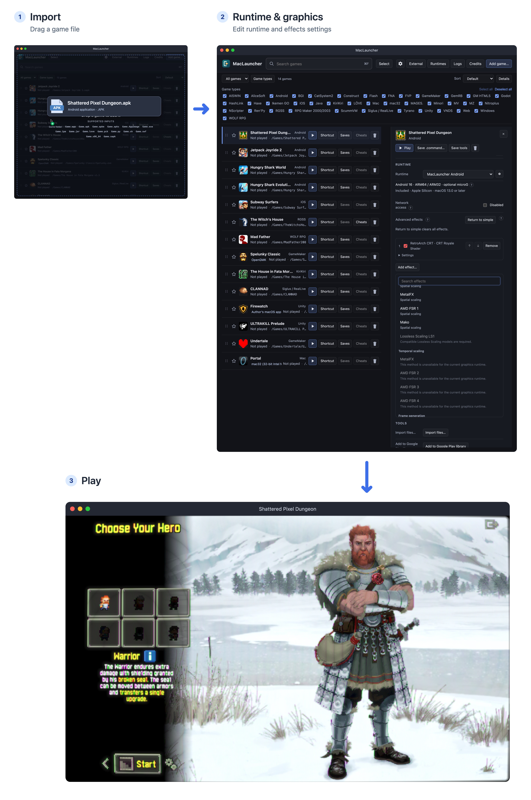

# MacLauncher

A macOS launcher for native game runtimes, Windows games, source tools and shared graphics effects.



Import a game, adjust optional runtime and graphics settings, then play.
Shown: [Shattered Pixel Dungeon](https://github.com/00-Evan/shattered-pixel-dungeon) with CRT Royale.

## Idea

MacLauncher connects original game data to macOS runtimes. Importing a game folder, executable or package identifies its engine and version; Play prepares the matching runtime and private game storage automatically. Sikarugir and CrossOver provide Windows executable playback alongside native engines.

The RPG Maker integration originated with the patches in [rpgmakermlinux-cicpoffs](https://github.com/bakustarver/rpgmakermlinux-cicpoffs). Engine modules now provide runtime selection, preparation, saves and tools through one launcher.

## Features

- Native macOS engines read original game data, with private configuration, generated files and saves.
- Managed runtime catalogs provide explicit version selection; automatic detection supplies engine and format requirements.
- Engine tools expose archive extraction, script decompilation, save inspection and cheats where the format provides them.
- Shared graphics controls provide ReShade, RetroArch and mpv shaders, upscaling and frame generation through the [graphics layer](docs/GRAPHICS.md).
- [Local video playback](docs/runtimes/VIDEO.md) uses managed mpv, native GPU scaling and optional graphics effects.
- Per-game network settings and runtime isolation use the same controls across backends.

MacLauncher is local first: game imports and runtime selection operate on local files. Runtime and tool downloads start from explicit actions. Game network access is controlled separately in each inspector. Electron supplies the launcher and the included web-game host.

[MacLauncher Builds](https://github.com/procrastinine/maclauncher-builds) supplies versioned MacLauncher runtime packages. The Runtimes window lists compatible versions and installs the selected package after download consent. Each runtime keeps its own architecture and minimum macOS requirements; installed versions remain available offline.

## Game support

The [module inventory](docs/MODULES.md#modules-and-backends) lists game types and runtime identifiers:

- **macOS apps:** native application launch, managed [mac32](docs/runtimes/MAC32.md) for 32-bit Intel apps, library management and explicit quarantine removal. mac32 0.1 requires macOS 26 or later and Rosetta on Apple Silicon.
- **Android:** [APK packages](docs/runtimes/ANDROID.md) through managed MacLauncher Android, Mac.apk or AIM runtimes on Apple Silicon.
- **iOS / iPadOS:** [PlayCover integration](docs/runtimes/IOS.md) for unencrypted ARM64 IPA packages, with private application storage and PlayTools input mapping.
- **RPGMaker:** 2000/2003 through [EasyRPG Player](https://github.com/EasyRPG/Player), MV/MZ through [Electron](https://github.com/electron/electron) or [NW.js](https://github.com/nwjs/nw.js), XP/VX/VX Ace through [MKXP-Z](https://github.com/mkxp-z/mkxp-z).
- **HTML games:** Electron and NW.js hosts for web exports, including Construct, TyranoBuilder and GameMaker HTML5.
- **Ren'Py**
- **Godot**
- **LÖVE**
- **GameMaker:** official GameMaker runtimes, [Butterscotch](https://github.com/ButterscotchRunner/Butterscotch) for GameMaker Studio and [OpenGMK](https://github.com/OpenGMK/OpenGMK) for GameMaker classic (custom macOS port).
- **Unity:** supported Mono profiles use an exact-version macOS Unity player. Windows IL2CPP games can use Sikarugir (Wine) or a registered CrossOver application; asset inspection and export remain available for both formats.
- **XNA/FNA:** with [FNA](https://github.com/FNA-XNA/FNA), [FNA3D](https://github.com/FNA-XNA/FNA3D), [FAudio](https://github.com/FNA-XNA/FAudio) and [.NET](https://github.com/dotnet/runtime).
- **WOLF RPG:** with [Browser Woditor](https://frostyhowl.com/browser-woditor/).
- **Flash (`.swf`):** via Adobe Flash Projector or [Ruffle](https://github.com/ruffle-rs/ruffle)
- **Java:** with [Temurin](https://github.com/adoptium/temurin-build) version management, [Vineflower](https://github.com/Vineflower/vineflower) decompilation, and [steamworks4j](https://github.com/code-disaster/steamworks4j).
- **Infinity Engine:** [GemRB](https://github.com/gemrb/gemrb).
- **Adventure games:** with [ScummVM](https://github.com/scummvm/scummvm).
- **MUGEN:** [Ikemen GO](https://github.com/ikemen-engine/Ikemen-GO).
- **Haxe:** [HashLink](https://github.com/HaxeFoundation/hashlink).
- **Visual novels:**
  - **NScripter:** [Onscripter-Yuri](https://github.com/YuriSizuku/OnscripterYuri), and a custom macOS port of [ONScripter-EN](https://github.com/Galladite27/ONScripter-EN).
  - **KiriKiri / KAG:** [krkrsdl2](https://github.com/krkrsdl2/krkrsdl2) and [KAG3](https://github.com/krkrsdl2/kag3).
  - **MAGES:** [Impacto](https://github.com/CommitteeOfZero/impacto)
  - **AI5WIN:** [AI5-SDL2](https://github.com/nunuhara/ai5-sdl2).
  - **AliceSoft:** [System3](https://github.com/kichikuou/system3-sdl2), [xsystem35](https://github.com/kichikuou/xsystem35-sdl2), and [xsystem4](https://github.com/nunuhara/xsystem4).
  - **Siglus / RealLive:** [siglus_rs](https://github.com/xmoezzz/siglus_rs) and [RLVM](https://github.com/eglaysher/rlvm) (RealLive-only for the latter).
  - **Nitroplus:** [NPengine](https://github.com/FGRE/libnpengine) and [libnpa](https://github.com/FGRE/libnpa).
  - **Minori:** [ReMinori](https://github.com/luoyily/ReMinori).
  - **FAVORITE / FVP:** [RFVP](https://github.com/xmoezzz/rfvp)
  - **VNDS:** [VNDS-LOVE](https://github.com/ajusa/VNDS-LOVE).
- **Other Windows executables:** [Sikarugir (Wine)](docs/runtimes/SIKARUGIR.md) provides managed runtime downloads, with graphics, locale, Wine and optional BepInEx settings. Locally installed [CrossOver](https://www.codeweavers.com/crossover/) applications can also be registered, including multiple versions. Both choices are available for compatible Windows exports of recognized engines. The [CrossOver guide](docs/runtimes/CROSSOVER.md) describes local application management.

Many of these also have decompilation and/or save editing tools. Some engines, like CatSystem2 and BGI, have inspection tools without a native interpreter; compatible Windows builds can use Sikarugir or CrossOver. The [runtime guides](docs/runtimes/README.md) describe formats, versions and tools.

For individual game source ports, decompilations and engine remakes, [Awesome Decomp Games](https://github.com/SubmitGame/awesome-decomp-games) provides a community project list, also linked from **Credits**. Platforms and game data requirements vary by project.

## Unique features

MacLauncher-owned adaptations connect engine APIs to macOS:
- RPG Maker cheats integrated with the game inspector and runtime.
- [OpenGMK on macOS](docs/runtimes/GAMEMAKER.md#classic-opengmk): AppKit input/windows, OpenGL, CoreAudio and original-read/private-write handling.
- Also, custom macOS ports of [ONScripter-EN](docs/runtimes/NSCRIPTER.md), [AI5](docs/runtimes/AI5.md), [KAG3](docs/runtimes/VN_ENGINES.md), and [ReMinori](docs/runtimes/MINORI.md).
- Automatic [offline Steam API support](docs/runtimes/STEAM_API.md) (for things needing Steam API before play).

[Attributions](docs/ATTRIBUTIONS.md) lists upstream projects, licenses and adaptation boundaries. MacLauncher's own code is [MIT licensed](LICENSE); upstream source, derived patches, tools, fonts and proprietary components retain their respective notices.

## Running the launcher

[Releases](https://github.com/procrastinine/maclauncher/releases) provide `MacLauncher.app.zip` for Apple Silicon and macOS 13 or later. Individual runtimes can require a newer macOS version. The app uses an ad hoc signature rather than Developer ID notarization. macOS provides its [Open Anyway control in System Settings → Privacy & Security](https://support.apple.com/en-us/102445).

## Development

Source builds require [Node.js](https://nodejs.org/en/download) 22.12+, 24 or 26 and [pnpm](https://pnpm.io/installation). The source setup commands are:

```sh
git clone https://github.com/procrastinine/maclauncher.git
cd maclauncher
node scripts/init-submodules.cjs
pnpm install --frozen-lockfile
pnpm dev
```

Source updates use `git pull --no-recurse-submodules`, `node scripts/init-submodules.cjs` and `pnpm install --frozen-lockfile`. The shared initializer fetches pinned build inputs while skipping unused nested and reference-only sources. `pnpm package:mac` builds the macOS app.

Launcher data and installed runtimes live in `~/Library/Application Support/maclauncher/`. `pnpm launch --game /path/to/game --wait` launches a game without the library window; `--inspect` reads its metadata.

## Docs

- [User guide](docs/README.md)
- [Runtime guides](docs/runtimes/README.md)
- [Tools and saves](docs/README.md#saves-cheats-and-source-tools)
- [Attributions](docs/ATTRIBUTIONS.md)
- [Backend and CLI](docs/BACKEND.md)
- [Development and app builds](docs/DEVELOPMENT.md)
- [Repository guide](docs/REPO_GUIDE.md)
