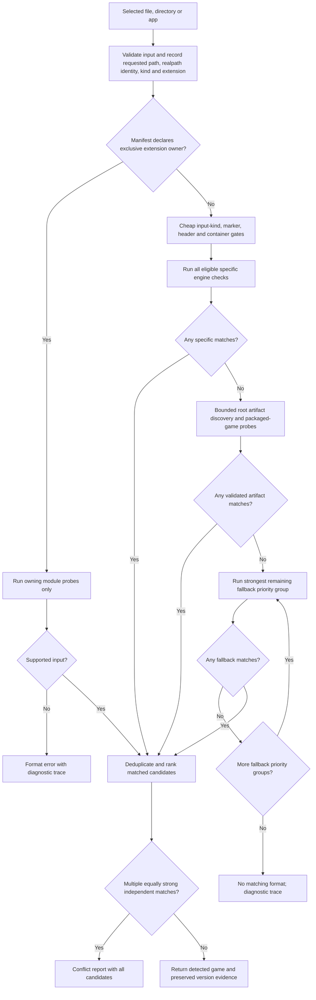

# Game detection pipeline

Game detection is an offline backend service. `src/modules/detection.js` owns input normalization, cached filesystem facts, staged probing, match aggregation, ambiguity and explainable diagnostics. `src/modules/registry.js` supplies dynamically discovered modules and preserves the public synchronous API. Each engine owns its layout, format and version checks; the pipeline does not branch on engine IDs or maintain a central engine-extension switch.

## Shared installer inputs

Imports first check shared input-container providers under
`src/modules/shared/installers/`. Inno Setup detection follows its loader
pointer or exact PE resource, validates the loader CRC and reads the versioned
setup header. A coincidental text string is insufficient. Ordinary executables
require no installer helper process.

The included [innoextract](https://github.com/dscharrer/innoextract) helper lists
actual required data parts and output paths. A completed, validated extraction
returns to the same engine registry used for ordinary folders. The import worker
reports progress and accepts cancellation independently of launcher selection,
tabs and game workers. Read-only registry diagnostics do not unpack installers.
[preparation and cache storage](GAME_PREPARATION.md) contains the corresponding reference.

## Stages and decision flow



1. **Input normalization.** The registry validates a regular file or directory, resolves its realpath identity and records whether it is an app bundle. Publisher application folders without an `.app` suffix are recognized from `Contents/Info.plist` declaring `APPL` and a contained executable in `Contents/MacOS`. Metadata reads are limited to 1 MiB, and executable recognition reads only its Mach-O or script prefix. Public game paths retain the selected spelling so existing library entries and relative game assets remain compatible. `input.canonicalPath` exposes the resolved identity for diagnostics. Detection does not execute selected files.
2. **Exclusive ownership.** Module manifests own `.swf`, `.jar`, `.love`, `.appimage`, `.py` launchers, shell `.sh` launchers, or `.pck` inputs. Ren'Py and the native macOS fallback share `.sh` and `.py` ownership: a recognized Ren'Py layout retains priority; other selected shell scripts or executable Python files with a shebang use native playback. Invalid direct inputs report the owning modules' format error; sibling web files cannot reclassify them. Adding an owner requires no registry code edit.
3. **Specific engine gates and aggregation.** Input kinds, allowed extensions, root/web markers and bounded file/container signatures decide which probes are worth running. Gates only admit a probe; its module still validates the content. Eligible independent checks are all collected rather than returning the alphabetically first result. A recognized directory layout avoids a broad scan of unrelated executables.
4. **Artifact probes before generic web.** If the root has no specific match, a bounded set of manifest-declared game files and PE/ELF binaries is inspected. For example, an NScripter or Tyrano executable alongside a generic `index.html` is classified by its archive contents before Web is considered. App bundles do not scan sibling executable candidates through this stage. A containing folder can also identify an immediate child application bundle through its normal engine probes and fallbacks, including publisher bundles without an `.app` suffix. This scan does not recurse into other folders. Multiple recognized child apps require selection of an individual app; existing root-level engine matches retain priority.
5. **Fallback declarations.** Fallbacks run in descending `priority` groups after specific layouts and artifacts fail. All eligible checks at the same priority run together; a recognized group prevents weaker groups from running. Web content precedes generic macOS game recognition, which precedes generic Windows recognition. Engine-specific native apps retain their engine module. The macOS fallback also accepts explicitly selected `.sh`, `.command`, `.bash` and `.zsh` text scripts, executable files with an absolute interpreter shebang, and executable Mach-O `MH_EXECUTE` images, including files without an extension. Every binary slice must use a Mac CPU and target macOS or Mac Catalyst when deployment metadata is present; static and legacy Mac images can omit that metadata. ELF, PE, object files, libraries and arbitrary executable-bit files do not qualify as native Mac executables. It never discovers arbitrary scripts in a selected folder. Native file entries retain the selected file as `gamePath`, its directory as `contentRootDir`, and `moduleData.executablePath` plus `launchKind` (`script` or `executable`). Generic Windows folder recognition requires exactly one valid top-level Windows `.exe`; nested executables alone do not classify a folder. Several valid top-level executables produce a conflict asking for one `.exe` to be selected. A selected executable is checked directly.
6. **Ambiguity reporting.** A selected validated artifact scores above a contextual sibling layout. A module can identify that artifact through its game path, `moduleData.packagedPath`, or explicit `detectionEvidence` with `{ type: "selected-artifact", path }`; this covers packaged engines that retain the parent folder as their game path. Specific directory layouts have equal strength. Duplicate matches for the same module/game path are combined. Two equally strong independent games/engines produce `DETECTION_CONFLICT` and all candidate evidence; neither label order nor filename order silently selects one. Module-reported `DETECTION_CONFLICT` errors retain their message and diagnostic trace instead of falling through to another detector. Equal-priority fallback matches retain the same ambiguity checks.

Detection identifies the engine, data format and version used for runtime selection. Modules check runtime and native-library requirements before launch.

AI5WIN gates its heavier checks on a known original INI, then validates script archive metadata and the actual start entry. Loose scripts additionally require original AI5 PE identity. The shared bounded PE reader keeps embedded file/product versions distinct from runtime selection and does not scan unrelated icon resources. [AI5 detection and versions](runtimes/AI5.md) contains the corresponding reference.

GameMaker separates WAD bytecode generation, stored GEN8 tuples and resource layout constraints. After validating the container and resource tables, its sprite-sequence probe examines at most 64 sprites and 64 KiB; it distinguishes the 32/40-byte headers and combines that evidence with audio-group bounds before choosing a runner. Missing or ambiguous layouts remain unresolved, and creator PE versions do not become compiler build identities. [GameMaker format matching](runtimes/GAMEMAKER.md) contains the corresponding reference.

Haxe native-build detection first requires an adjacent `lime.ndll`. Bounded PE export tables must then identify executable `hx_cffi` code in the game and matching-CPU Lime CFFI application/window functions in the DLL. Forwarded exports, data exports and Haxe class strings alone do not match. At most 16 executable candidates and 128 KiB of each image's read-only string section are inspected; these facts reuse the session cache. Reported hxcpp build metadata describes the C++ support library, not the Haxe compiler or game version. Windows native C++ builds are importable for inspection and can use Sikarugir or an available CrossOver application; genuine `HLB` bytecode remains a separate HashLink format. [Haxe targets and limits](runtimes/OTHER_ENGINES.md#haxe-native-builds) contains the corresponding reference.

FAVORITE/FVP validates a compiled HCB/BCH scenario descriptor, entry point,
resolution and recognized engine syscall names. BIN resource indexes provide
additional format evidence without reading entire assets. The validated scenario
identifies the engine independently of the Windows executable's filename.
Several different scenario basenames require selecting a particular scenario.
Format evidence is separate from RFVP runtime version and gameplay compatibility. See
[FVP formats and limits](runtimes/FVP.md).

## Module declaration

`manifest.detection` (or a backend module's `detection` override) supports the following fields:

| Field | Meaning |
| --- | --- |
| `inputKinds` | Allowed `directory`, `file`, `app` kinds. |
| `extensions` | Objects such as `{ "extension": ".love", "exclusive": true }`; direct-input ownership. |
| `fileExtensions` | Allowed direct file extensions. |
| Game dialog | The registry derives its extension filter from these declarations and app/ELF capabilities, so new modules update import choices automatically. All Files remains available for extensionless inputs. |
| `binaryFormats` | Validated PE/ELF/Godot header alternatives for files with platform suffixes or no extension. |
| `fileSignatures` | Bounded `{ hex, offset?, minSize? }` checks; at least one must match. |
| `rootMarkers` | Relative files/directories that justify a layout probe; gates accept unambiguous case variants. |
| `rootExtensions` | Root-level file extensions that justify probing. |
| `webMarkers` | Relative engine markers beneath a resolved HTML entry's directory. |
| `webContent` | HTML presence admits a probe, useful when the module inspects generator/runtime markers. |
| `webRoots` | Additional relative content roots, including NW.js app layouts. |
| `containerFormats` | Required format hints for otherwise unmarked file inputs: `zip`, `rar`, `7z`, `enigma`, `nsis`, `inno`, `cab`, `pe`, `elf`, `godot`, `appimage`. |
| `directFileExtensions` | Formats a module validates directly without the generic container gate. |
| `directoryFileExtensions` | Root-level artifact extensions to inspect after specific layout checks fail. |
| `probeExecutables` | Admit/discover root PE/ELF files even without an executable permission bit or conventional suffix. |
| `allowUnmarkedDirectory` | A module may perform its own cheap conservative directory checks. |
| `worker` | Expensive file probes may run in worker threads through the async API. |
| `fallback` / `priority` | Generic fallback classification and relative priority. Higher groups run first; detection stops after the first recognized group. Equal-priority checks retain conflict aggregation. |

Existing modules use these declarations, including RPG Maker variants, Ren'Py, GameMaker Classic/Studio and HTML5 exports, Godot, LÖVE, Java, Flash, Construct, Tyrano, NScripter, HashLink, native Haxe builds, GemRB, Ikemen, KiriKiri, AliceSoft, Web and generic apps. Their detectors remain the authoritative validators. Manifest declarations supply cheap probe gates and format ownership; undeclared modules retain direct probing.

NScripter checks loose script/archive root markers before executable container inspection. Plaintext and classic XOR scripts then require a `*define`/`*start` label plus a recognized command in a cached, bounded 64 KB prefix; empty or unrelated `0.txt` files do not classify as games. Verified script paths contribute selected-artifact evidence, while executable-key/NT formats retain explicit reserved-format evidence without scanning executables for decryption. Dragging an ordinary `nscr.exe` beside its valid scripts therefore avoids archive probes. Declared ONScripter-EN UTF script names are part of the same cheap root gate; runtime selection does not require another game-type detector.

Modules receive cached helpers as their second detection argument and as `context.detection`: `stat`, `readdir`, `readBytes`, `readText`, `findIndexHtml`, `fileFacts`, `readZipEntries`, `readArchiveEntries`, `readAsarHeader` and `memo(namespace, key, callback)`. Helpers are optional for standalone module calls. These helpers share format metadata across engine probes.

## Caching, concurrency and bounds

Each detection call owns a fresh session. It caches stat results, directory entries, bounded reads, HTML entry resolution, file/container facts, ZIP directories, archive listings and ASAR headers. A fresh call observes filesystem changes rather than reusing process-wide stale results. `package.json` main entries must be local HTML files inside their content root; traversal, escaping symlinks and directories masquerading as `index.html` are rejected.

The launcher also has a persistent **per-game metadata cache** above individual
detection sessions (`src/core/game-metadata.js`). It records source read/directory/
missing-path observations, source identities and relevant settings, then reuses
detection/icon/save facts across launcher restarts while those observations match.
An invalid cache starts a fresh session; an explicit inspect still runs the pipeline.
Module direct filesystem reads are captured in the scoped backend-worker metadata
operation, independently of session-helper hit metrics. Notes and launch bookkeeping
do not trigger archive parsing. Workers already isolating a whole metadata operation
may use `workerMode: "inline"` to avoid spawning nested CPU workers; the public async
pipeline retains its normal bounded-worker behavior.

The registry retains `detectGame(path, options?)` and adds `detectGameAsync(path, options?)`. Async-only modules may export `detectGameAsync(context, helpers)`. Genuine asynchronous probes overlap with bounded concurrency within a stage or fallback priority group. Existing synchronous CPU checks stay synchronous unless their declaration opts expensive file probes into worker threads. Workers import backend modules, never game scripts or executable game entry points. Worker errors preserve their detection codes. When a probe reports a conflict or limit, already-running checks finish before the error report returns; no weaker fallback group starts.

Async detection preloads each eligible ZIP directory once and each recognized SFX archive inventory once, then supplies the read-only results to workers. Shared 7-Zip inventories use a non-blocking native metadata-reader process, with a 10-second deadline and 16 MiB output cap. Ordinary PE executables lack archive hints and do not start 7-Zip or Python extraction helpers. Enigma detection uses a bounded section-name hint before its module-owned helper. Archive signature searches read the first 1 MiB of an executable stub.

Default session limits are 256 enumerated directories, 4,096 entries per directory, 8,192 stat facts, 32 candidate game files, 64 MiB helper-read budget, 16 MiB ZIP-directory/ASAR-header sizes, three simultaneous async probes/workers, and a 20-second worker deadline. Callers can lower limits. Excessive candidate directories ask the user to select an individual file. Legacy module-internal direct reads are not counted as cache hits; session metrics count helper-managed operations and dispatch.

## Version evidence and explanations

Module detection data passes through unchanged to runtime selection. Diagnostics add a version-evidence summary with the detected value, source, confidence, generation/variant and major/minor when supplied. Exact format-header versions remain distinct from inferred versions such as `3.1.x`; reported values without a declared source/confidence are labeled `reported`, and absent versions remain `unknown`. A game app version and a bundled runner's revision are not substituted for the game's engine version. Runtime versions/options remain managed by their existing module runtime managers.

The inspector shows the engine and a meaningful detected version beside the game. **Details** contains format, source and confidence; RPG Maker MV/MZ omit inapplicable version and confidence rows. **Detection diagnostics** exposes the bounded probe trace and an explicit refresh. The offline CLI provides the same report:

```sh
pnpm launch --game /path/to/game --inspect
```

The backend APIs are `registry.explainDetection(path, options?)` and `await registry.explainDetectionAsync(path, options?)`. They return `maclauncher-detection-v1` reports containing `input`, `detected`, `selectedModuleId`, `candidates`, `versions`, `trace`, `metrics`, `limits` and an optional `error`. A trace explains skips, matches, probe errors, stages and supporting evidence. Explain calls return reports for unmatched or conflicting inputs; detect calls throw a `DetectionError` with the same report on `.detection`. Inspection does not import a game, download a runtime or write launcher state.

