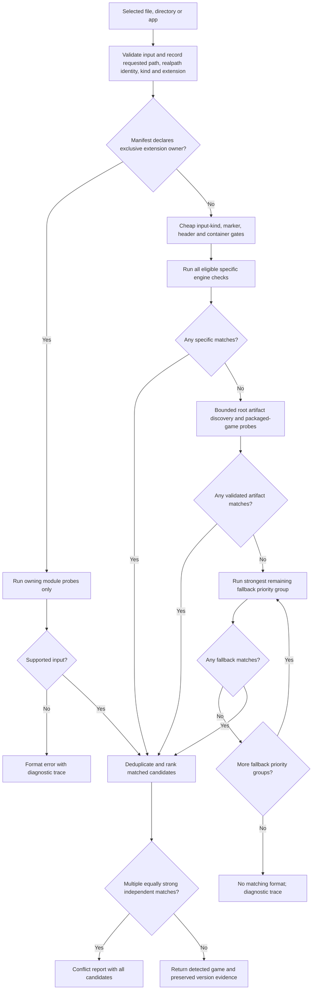

# Game detection

When a game is imported, detection identifies its game type (the engine), its data format and its version, and the result decides which runtime is used. Detection runs offline in the backend and never executes the selected files; runtime and native-library requirements are checked later, before launch.

Each module checks the layout, formats and versions of its own engine. The pipeline in `src/modules/detection.js` handles everything shared: it normalizes the input, caches filesystem facts, runs the checks in stages, combines the matches, reports conflicts and explains its decisions. `src/modules/registry.js` supplies the modules it discovers and keeps the public synchronous API. The pipeline never branches on engine IDs and has no central table of engine extensions.

## Versions and diagnostics

The inspector shows the engine and its detected version next to the game. The **Details** disclosure lists the format, the source of the version and its confidence; RPG Maker MV and MZ leave out the version and confidence rows, which do not apply to them. The **Detection** disclosure shows the probe trace, within its limits, and has a button to run detection again.

Exact versions read from a format header are kept apart from inferred versions such as `3.1.x`. A version that a module reports without a source or confidence is labeled `reported`, and a missing version stays `unknown`. A game's app version, or the revision of a runner bundled with it, never stands in for the game's engine version. Detection passes the module's data unchanged to runtime selection, and each module's runtime manager keeps managing runtime versions and options.

The offline command line prints the same report:

```sh
pnpm launch --game /path/to/game --inspect
```

## How detection proceeds



### Input

The registry checks that the selection is a regular file or a directory, resolves its real path and records whether it is an app bundle. A publisher's application folder without the `.app` suffix counts as an app when its `Contents/Info.plist` declares `APPL` and `Contents/MacOS` contains an executable. Metadata reads are limited to 1 MiB, and recognizing an executable reads only its Mach-O header or script prefix.

The game path keeps the spelling of the selection, so existing library entries and relative game assets stay valid. `input.canonicalPath` gives the resolved path for diagnostics.

### Exclusive extensions

Some extensions belong to particular modules, which declare them in their manifests: `.swf`, `.jar`, `.love`, `.appimage`, `.pck`, and `.py` and `.sh` launchers. A file with one of these extensions is checked only by the modules that own it. An invalid file reports their format error, and web files next to it cannot reclassify it. A new owner needs only a manifest declaration, with no change to the registry code.

Ren'Py and the native macOS fallback share `.sh` and `.py`. A recognized Ren'Py layout takes priority; other shell scripts, and executable Python files with a shebang, play natively.

### Specific engine checks

Quick checks of the input kind, the extension, root and web markers, and file or container signatures decide which engine checks are worth running. Each of these quick checks reads only a limited amount of data, and passing one only allows an engine check to run: the module still validates the content. Detection runs every eligible check and collects all matches, instead of returning the first match in alphabetical order. A recognized directory layout avoids a broad scan of unrelated executables.

### Packaged games and app folders

If no specific check matches the folder, detection inspects a limited set of game files declared in module manifests, and the PE and ELF binaries in the folder. An NScripter or Tyrano executable next to a generic `index.html`, for example, is classified by its archive contents before Web is considered. App bundles skip this scan of sibling executables.

A folder can also be identified by an application bundle directly inside it, through that bundle's usual engine checks and fallbacks, including publisher bundles without the `.app` suffix. This scan does not descend into other folders. A folder with several recognized apps needs one app selected, and an engine match at the folder's root still takes priority.

Game executables rank above setup, configuration, settings, launcher, uninstaller, redistributable and crash-reporter utilities, although a utility that is selected directly is still accepted. When a selected folder matches no game and contains exactly one visible subfolder, detection tries that subfolder within the same session limits.

### Fallbacks

Fallback checks run only after the specific layouts and packaged-game checks fail. They run in groups of descending `priority`: every eligible check in a group runs, and a group that recognizes the game stops the weaker groups. Web content comes before the generic macOS game check, which comes before the generic Windows check. Native apps of a specific engine keep that engine's module.

The macOS fallback accepts these selections:

- `.sh`, `.command`, `.bash` and `.zsh` text scripts
- executable files with an absolute interpreter shebang
- executable Mach-O `MH_EXECUTE` images, including files without an extension

Every slice of a binary must use a Mac CPU, and must target macOS or Mac Catalyst when it has deployment metadata; static and legacy Mac images can lack that metadata. ELF and PE files, object files, libraries and arbitrary files with the executable bit set do not count as Mac executables. The fallback never searches a selected folder for scripts. A native file entry keeps the selected file as `gamePath`, its folder as `contentRootDir`, and `moduleData.executablePath` with a `launchKind` of `script` or `executable`.

A folder matches the generic Windows check only when it has exactly one valid Windows `.exe` at its top level; executables in subfolders do not count. Several valid top-level executables produce a conflict that asks for one `.exe` to be selected. A selected executable is checked directly.

### Conflicts

A validated file that was selected directly ranks above a sibling layout that only provides context. A module marks such a file through its game path, `moduleData.packagedPath` or explicit `detectionEvidence` of the form `{ type: "selected-artifact", path }`; packaged engines that keep the parent folder as their game path use this. All specific directory layouts have equal strength, and duplicate matches for the same module and game path are merged.

Two equally strong matches for independent games or engines produce `DETECTION_CONFLICT` with the evidence for every candidate. Neither the order of the labels nor the order of the file names chooses one silently. A `DETECTION_CONFLICT` reported by a module keeps its message and trace, and detection does not fall through to another detector. Fallback matches of equal priority go through the same conflict checks.

## Installers

Before engine detection, an import checks whether the input is an installer, using the shared input-container providers in `src/modules/shared/installers/`. An Inno Setup installer is identified by following its loader pointer or its exact PE resource, validating the loader CRC and reading the versioned setup header; a matching text string alone is not enough. Ordinary executables start no installer helper process.

The [installer reader](../tools/INSTALLERS.md) lists the data parts and output paths that an installer actually needs. After a complete, validated extraction, the extracted game goes through the same engine registry as an ordinary folder. The import worker reports progress and can be cancelled, independently of launcher selection, tabs and game workers. Read-only registry diagnostics never unpack installers. [Installer extraction](GAME_PREPARATION.md#installer-extraction) describes the extraction cache.

## Detection evidence by game type

Most game-type pages describe their own detection. For these game types, the checks interact with the pipeline's stages and limits:

| Game type | Evidence | Limits |
| --- | --- | --- |
| [AI5WIN](../game-types/AI5.md#detection-and-versions) | Heavier checks start only when a known original INI file is present. Detection then validates the script archive metadata and the actual start entry, and loose scripts also need an original AI5 PE identity. The shared PE reader keeps the embedded file and product versions apart from runtime selection. | The PE reader does not scan unrelated icon resources. |
| [FAVORITE / FVP](../game-types/FVP.md#game-formats) | A compiled HCB or BCH scenario descriptor with a valid entry point, resolution and recognized engine system-call names. BIN resource indexes add evidence. The scenario identifies the engine whatever the Windows executable is called. | BIN indexes are read without reading whole assets. Several different scenario names require selecting one scenario. The scenario format and the selected RFVP version are separate metadata. |
| [GameMaker](../game-types/GAMEMAKER.md#formats-and-version-detection) | The WAD bytecode generation, stored GEN8 tuples and resource layout constraints. After the container and resource tables are validated, a sprite-sequence probe tells 32-byte from 40-byte headers, and audio-group bounds add evidence before a runner is chosen. | The sprite probe reads at most 64 sprites and 64 KiB. Missing or ambiguous layouts stay unresolved, and the version of the creator's PE file never becomes a compiler build identity. |
| [Haxe native build](../game-types/HAXE.md#detection-and-versions) | A `lime.ndll` next to the game is required. PE export tables must then show executable `hx_cffi` code in the game, and Lime CFFI application and window functions for the matching CPU in the DLL. Forwarded exports, data exports and Haxe class strings alone do not match. Reported hxcpp build metadata describes the C++ support library, not the Haxe compiler or the game's version. HashLink `HLB` bytecode is a separate format. | At most 16 executable candidates, and 128 KiB of each image's read-only string section. The facts reuse the session cache. |
| [Nintendo Switch](../game-types/SWITCH.md#accepted-inputs) | NSO and NRO headers, PFS0 and HFS0 directory metadata and XCI partition signatures. Extracted ExeFS/RomFS applications and loose modules are recognized for inspection, separately from container playback. | Container metadata reads are limited to 2 MiB. Detection performs no extraction, decompression, key-content reads or catalog queries. |
| [NScripter](../game-types/NSCRIPTER.md#detection) | Loose script and archive markers at the root are checked before executable containers. Plaintext and classic XOR scripts need a `*define` or `*start` label and a recognized command. Verified script paths count as selected-file evidence, so an ordinary `nscr.exe` next to valid scripts needs no archive probes. Executable-key and NT formats are recognized from reserved format markers, without scanning executables for decryption. The declared ONScripter-EN UTF script names are part of the same root check, so runtime selection needs no second detector. | The script check reads a 64 KB prefix once and caches it. Empty or unrelated `0.txt` files do not match. |
| [PlayStation 5](../game-types/PS5.md#accepted-inputs) | ELF and SELF magic numbers and extensions, then x86-64 PS5 executable headers and `sce_sys/param.json` title metadata. | Metadata reads are limited to 128 KiB. Detection does not unpack containers, convert programs, walk resource trees or query runtime catalogs. |

## Module declarations

A module declares its detection in `manifest.detection`, or a backend module overrides it with its own `detection`. The declarations decide cheaply which probes run and which module owns an extension; each module's detector still makes the final decision, and modules without declarations are probed directly. Existing modules use declarations, including the RPG Maker variants, Ren'Py, GameMaker Classic and Studio, GameMaker HTML5, Godot, LÖVE, Java, Flash, Construct, Tyrano, NScripter, HashLink, Haxe native builds, GemRB, Ikemen, KiriKiri, AliceSoft, Web and the generic app modules.

| Field | Meaning |
| --- | --- |
| `inputKinds` | Allowed input kinds: `directory`, `file`, `app`. |
| `extensions` | Objects such as `{ "extension": ".love", "exclusive": true }`; with `exclusive`, only this module checks directly selected files with that extension. |
| `fileExtensions` | Allowed extensions of directly selected files. |
| `binaryFormats` | Validated PE, ELF or Godot header alternatives for files with platform suffixes or no extension. |
| `fileSignatures` | Limited `{ hex, offset?, minSize? }` checks; at least one must match. |
| `rootMarkers` | Relative files or folders that justify a layout probe; case variants match when unambiguous. |
| `rootExtensions` | File extensions at the root that justify a probe. |
| `webMarkers` | Relative engine markers below the folder of the resolved HTML entry page. |
| `webContent` | The presence of HTML allows a probe, for modules that inspect generator or runtime markers. |
| `webRoots` | Additional relative content roots, including NW.js app layouts. |
| `containerFormats` | Required format hints for otherwise unmarked files: `zip`, `rar`, `7z`, `enigma`, `nsis`, `inno`, `cab`, `pe`, `elf`, `godot`, `appimage`. |
| `directFileExtensions` | Formats the module validates directly, without the generic container check. |
| `directoryFileExtensions` | Extensions of root-level files to inspect after the specific layout checks fail. |
| `probeExecutables` | Allows and discovers PE and ELF files at the root even without the executable bit or a conventional suffix. |
| `allowUnmarkedDirectory` | The module performs its own quick, conservative directory checks. |
| `worker` | Expensive file probes may run in worker threads through the async API. |
| `fallback` / `priority` | Generic fallback classification and its priority. Higher groups run first, and detection stops after the first group that recognizes the game. Checks of equal priority still go through conflict aggregation. |

The registry builds the import dialog's file filter from these declarations and from app and ELF capabilities, so a new module's formats appear in the dialog automatically. All Files stays available for inputs without an extension.

Modules receive cached helpers as their second detection argument and as `context.detection`: `stat`, `readdir`, `readBytes`, `readText`, `findIndexHtml`, `fileFacts`, `readZipEntries`, `readArchiveEntries`, `readAsarHeader` and `memo(namespace, key, callback)`. The helpers share format metadata between engine probes, and standalone module calls work without them.

## Caching, concurrency and limits

Each detection call has its own session. The session caches stat results, directory entries, partial reads, HTML entry resolution, file and container facts, ZIP directories, archive listings and ASAR headers. Nothing is cached across calls, so a new call sees the current filesystem. A `package.json` main entry must be a local HTML file inside its content root; path traversal, symbolic links that escape the root and directories named like `index.html` are rejected.

The registry keeps `detectGame(path, options?)` and adds `detectGameAsync(path, options?)`. Async-only modules may export `detectGameAsync(context, helpers)`. Truly asynchronous probes overlap, up to a fixed number at a time, within a stage or fallback priority group. Synchronous CPU checks stay synchronous unless their declaration moves expensive file probes to worker threads. Workers import backend modules, never game scripts or a game's executable entry points, and worker errors keep their detection codes. When a probe reports a conflict or a limit, the checks already running finish before the error is reported, and no weaker fallback group starts.

Async detection reads each eligible ZIP directory once and the inventory of each recognized self-extracting archive once, then gives the read-only results to the workers. Shared 7-Zip inventories come from a non-blocking native metadata reader process with a 10-second deadline and a 16 MiB output limit. Ordinary PE executables have no archive hints and start neither 7-Zip nor Python extraction helpers. Enigma detection checks a section-name hint, with a limited read, before running its module's helper. Archive signature searches read the first 1 MiB of an executable stub.

The default session limits are:

- 256 directories enumerated, 4,096 entries per directory and 8,192 stat facts
- 32 candidate game files and a 64 MiB budget for helper reads
- 16 MiB for a ZIP directory or ASAR header
- three async probes or workers at a time, with a 20-second worker deadline

Callers can lower these limits. When a selection has too many candidate folders, the user is asked to select an individual file. Session metrics count the operations and dispatches that go through the helpers; direct reads inside older module code are not counted as cache hits.

### Per-game metadata cache

Above the individual sessions, the launcher keeps a persistent metadata cache for each game in `src/core/game-metadata.js`. It records the source reads, directory listings and missing paths it observed, together with the identities of the source files and the relevant settings, and reuses detection, icon and save facts across launcher restarts while those observations still match. An invalid cache starts a fresh session, and an explicit inspection always runs the pipeline.

The backend worker's scoped metadata operation also captures a module's direct filesystem reads, independently of the helper hit metrics. Notes and launch bookkeeping never trigger archive parsing. Workers that already isolate a whole metadata operation may pass `workerMode: "inline"` to avoid starting nested CPU workers, while the public async pipeline keeps its usual limited workers.

## Backend API

`registry.explainDetection(path, options?)` and `await registry.explainDetectionAsync(path, options?)` return a `maclauncher-detection-v1` report with `input`, `detected`, `selectedModuleId`, `candidates`, `versions`, `trace`, `metrics`, `limits` and an optional `error`. The version evidence lists the detected value, its source and confidence, and the generation, variant, major and minor version when the module supplies them. The trace explains skipped checks, matches, probe errors and stages, with the supporting evidence.

The explain calls return a report for unmatched or conflicting inputs too, while the detect calls throw a `DetectionError` that carries the same report in `.detection`. Explaining detection does not import the game, download a runtime or write launcher state.
