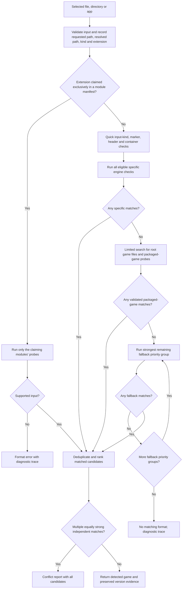

# Game detection

When a game is imported, detection works out its game type (the engine), its data format and its version, and that result decides which runtime is used. Detection runs offline in the backend and never executes the selected files; runtime and native-library requirements are checked later, before launch. An unrecognized plain folder that holds a single item, not counting macOS metadata, is treated as a wrapper: detection repeats with that item, continues through any further single-item folders, and imports the recognized inner item directly. Recognized folders and macOS bundles are never unwrapped this way.

The work is split between engine modules and a shared pipeline. Each module checks the layouts, formats and versions of its own engine. Everything the modules have in common is handled by the pipeline in `src/modules/detection.js`, which normalizes the input, caches filesystem facts, runs the checks in stages, combines the matches, reports conflicts and explains its decisions. The pipeline never branches on engine IDs and has no central table of engine extensions. Its modules come from `src/modules/registry.js`, which discovers them and also keeps the public synchronous API.

## Versions and diagnostics

The inspector shows the engine and its detected version next to the game. Under the **Details** disclosure are the format, the source of the version and its confidence, although RPG Maker MV and MZ leave out the version and confidence rows because they do not apply there. The **Detection** disclosure shows the probe trace as far as its limits allow, together with a button that runs detection again.

Exact versions read from a format header are kept apart from inferred versions such as `3.1.x`. When a module reports a version without a source or confidence, it is labeled `reported`, and a missing version stays `unknown`. Neither a game's app version nor the revision of a runner bundled with it ever stands in for the game's engine version. Detection hands the module's data to runtime selection unchanged, and runtime versions and options remain the job of each module's runtime manager.

The offline command line prints the same report:

```sh
pnpm launch --game /path/to/game --inspect
```

## How detection proceeds



### Input

The registry first checks that the selection is a regular file or a directory, then resolves its real path and records whether it is an app bundle. A publisher's application folder without the `.app` suffix also counts as an app when its `Contents/Info.plist` declares `APPL` and `Contents/MacOS` contains an executable. Metadata reads are limited to 1 MiB, and recognizing an executable reads only its Mach-O header or script prefix.

Because the game path keeps the spelling of the selection, existing library entries and relative game assets stay valid. The resolved path is kept in `input.canonicalPath` for diagnostics.

### Exclusive extensions

A module can claim an extension exclusively by declaring it in its manifest. The extensions claimed this way are `.swf`, `.jar`, `.love`, `.appimage`, `.pck`, and `.py` and `.sh` launchers. A file with one of them is checked only by the modules that claim it, so an invalid file reports their format error, and web files next to it cannot reclassify it. Claiming a new extension takes only a manifest declaration, with no change to the registry code.

Ren'Py and the native macOS fallback both claim `.sh` and `.py`. A recognized Ren'Py layout wins, and any other shell script, or executable Python file with a shebang, plays natively.

### Specific engine checks

Quick checks of the input kind, the extension, root and web markers, and file or container signatures decide which engine checks are worth running. Each quick check reads only a limited amount of data. Passing one merely lets an engine check run, since the module still validates the content itself. Detection runs every eligible check and collects all of their matches instead of returning the first match in alphabetical order. When a directory layout is recognized, unrelated executables are not scanned.

### Packaged games and app folders

If no specific check matches the folder, detection inspects a limited set of game files declared in module manifests, along with the PE and ELF binaries in the folder. An NScripter or Tyrano executable next to a generic `index.html`, for example, is classified by its archive contents before Web is considered. App bundles skip this scan of sibling executables.

A folder can also be identified by an application bundle directly inside it, including a publisher bundle without the `.app` suffix, which then goes through its usual engine checks and fallbacks. This scan does not descend into other folders. When a folder holds several recognized apps, one of them has to be selected, and an engine match at the folder's root still takes priority over all of them.

Game executables rank above setup, configuration, settings, launcher, uninstaller, redistributable and crash-reporter utilities, although a utility that is selected directly is still accepted. When a selected folder matches no game and contains exactly one visible subfolder, detection tries that subfolder within the same session limits.

### Fallbacks

Fallback checks classify the inputs that no specific layout or packaged-game check recognizes, so they run only after those checks fail. They run in groups of descending `priority`. Every eligible check in a group runs, and once a group recognizes the game, the weaker groups are skipped. Web content comes first, then the generic macOS game check, then the generic Windows check. A native app built with a specific engine is still handled by that engine's module.

The macOS fallback accepts these selections:

- `.sh`, `.command`, `.bash` and `.zsh` text scripts
- executable files with an absolute interpreter shebang
- executable Mach-O `MH_EXECUTE` images, including files without an extension

Every slice of a binary must use a Mac CPU and, when it has deployment metadata, target macOS or Mac Catalyst; static and legacy Mac images can lack that metadata. ELF and PE files, object files, libraries and arbitrary files with the executable bit set do not count as Mac executables. The fallback never searches a selected folder for scripts. For a native file, the library entry records the selected file as `gamePath`, its folder as `contentRootDir`, and `moduleData.executablePath` with a `launchKind` of `script` or `executable`.

The generic Windows check matches a folder only when it has exactly one valid Windows `.exe` at its top level; executables in subfolders do not count. When there are several valid top-level executables, the result is a conflict that names each of them as a choice and asks for one `.exe` to be selected. A selected executable is checked directly.

### Conflicts

A validated file that was selected directly ranks above a sibling layout that only provides context. Modules mark such a file through its game path, `moduleData.packagedPath` or explicit `detectionEvidence` of the form `{ type: "selected-artifact", path }`, and packaged engines that keep the parent folder as their game path mark their selected file this way. All specific directory layouts have equal strength, and duplicate matches for the same module and game path are merged.

Two equally strong matches for independent games or engines produce `DETECTION_CONFLICT` with the evidence for every candidate, so neither the order of the labels nor the order of the file names can pick one silently. When a module reports `DETECTION_CONFLICT` itself, its message, trace and choices are kept, and detection does not fall through to another detector. Each entry in the report's `error.choices` is an absolute path that selects one of the possible games: an executable or program that a module names, the game file of one of several equally strong packaged-game matches, or the app bundle of one of several matching child apps. Two modules that claim the same path name no choices. Fallback matches of equal priority go through the same conflict checks.

### Damaged or incomplete inputs

A module can recognize its own input format and still find the input unusable, such as a Switch dump folder without RomFS. In that case it reports `DETECTION_INVALID_INPUT` with a short plain message, which the trace records, and optionally a technical detail that goes to the log instead of the screen. Detection then continues with the other modules and uses a match from any of them. If none matches, the result is `DETECTION_INVALID_INPUT` with the first such message instead of `DETECTION_UNSUPPORTED`, and import shows the message after the item's name: “Example” could not be added. Switch dump is missing RomFS.

## Installers

Before engine detection, an import checks whether the input is an installer, using the shared installer readers in `src/modules/shared/installers/`. To identify an Inno Setup installer, MacLauncher follows its loader pointer or its exact PE resource, validates the loader CRC and reads the versioned setup header; a matching text string alone is not enough. Ordinary executables start no installer helper process.

The [installer reader](../tools/INSTALLERS.md) lists the data parts and output paths that an installer actually needs. Once an extraction is complete and validated, the extracted game goes through the same engine registry as an ordinary folder. The import worker reports progress and can be cancelled independently of launcher selection, tabs and game workers. Read-only registry diagnostics never unpack installers. The extraction cache is described in [Installer extraction](GAME_PREPARATION.md#installer-extraction).

## Detection evidence by game type

Most game-type pages describe their own detection. For the game types below, the checks interact with the pipeline's stages and limits:

| Game type | Evidence | Limits |
| --- | --- | --- |
| [AI5WIN](../game-types/AI5.md#detection-and-versions) | Heavier checks start only when a known original INI file is present. Detection then validates the script archive metadata and the actual start entry, and loose scripts also need an original AI5WIN executable that is recognized on its own. The shared PE reader keeps the embedded file and product versions apart from runtime selection. | The PE reader does not scan unrelated icon resources. |
| [FAVORITE / FVP](../game-types/FVP.md#game-formats) | A compiled HCB or BCH scenario descriptor with a valid entry point, resolution and recognized engine system-call names. BIN resource indexes add evidence. Because the scenario identifies the engine, the name of the Windows executable does not matter. | BIN indexes are read without reading whole assets. Several different scenario names require selecting one scenario. The scenario format and the selected RFVP version are separate metadata. |
| [GameMaker](../game-types/GAMEMAKER.md#formats-and-version-detection) | The WAD bytecode generation, stored GEN8 tuples and resource layout constraints. After the container and resource tables are validated, a sprite-sequence probe tells 32-byte from 40-byte headers, and audio-group bounds add evidence before a runner is chosen. | The sprite probe reads at most 64 sprites and 64 KiB. Missing or ambiguous layouts stay unresolved, and the version of the creator's PE file is never taken as the compiler build. |
| [Haxe native build](../game-types/HAXE.md#detection-and-versions) | A `lime.ndll` next to the game is required. PE export tables must then show executable `hx_cffi` code in the game, and Lime CFFI application and window functions for the matching CPU in the DLL. Forwarded exports, data exports and Haxe class strings alone do not match. Reported hxcpp build metadata describes the C++ support library and says nothing about the Haxe compiler or the game's version. HashLink `HLB` bytecode is a separate format. | At most 16 executable candidates, and 128 KiB of each image's read-only string section. The facts reuse the session cache. |
| [Nintendo Switch](../game-types/SWITCH.md#accepted-inputs) | NSO and NRO headers, PFS0 and HFS0 directory metadata and XCI partition signatures. Extracted ExeFS/RomFS applications and loose modules are recognized for inspection, separately from container playback. | Container metadata reads are limited to 2 MiB. Detection performs no extraction, decompression, key-content reads or catalog queries. |
| [NScripter](../game-types/NSCRIPTER.md#detection) | Loose script and archive markers at the root are checked before executable containers. Plaintext and classic XOR scripts need a `*define` or `*start` label and a recognized command. Verified script paths count as evidence of a selected file, so an ordinary `nscr.exe` next to valid scripts needs no archive probes. Executable-key and NT formats are recognized from reserved format markers, without scanning executables for decryption. The declared ONScripter-EN UTF script names are part of the same root check, so runtime selection needs no second detector. | The script check reads a 64 KB prefix once and caches it. Empty or unrelated `0.txt` files do not match. |
| [PlayStation 5](../game-types/PS5.md#accepted-inputs) | ELF and SELF magic numbers and extensions, then x86-64 PS5 executable headers and `sce_sys/param.json` title metadata. | Metadata reads are limited to 128 KiB. Detection does not unpack containers, convert programs, walk resource trees or query runtime catalogs. |

## Module declarations

With declarations, the pipeline can decide cheaply which probes run and which module has claimed an extension. A module declares its detection in `manifest.detection`, and a backend module can override that with its own `detection`. Each module's detector still makes the final decision, and modules without declarations are probed directly. Declarations are used by the RPG Maker variants, Ren'Py, GameMaker Classic and Studio, GameMaker HTML5, Godot, LÖVE, Java, Flash, Construct, Tyrano, NScripter, HashLink, Haxe native builds, GemRB, Ikemen, KiriKiri, AliceSoft, Web and the generic app modules.

| Field | Meaning |
| --- | --- |
| `inputKinds` | Allowed input kinds: `directory`, `file`, `app`. |
| `extensions` | Objects such as `{ "extension": ".love", "exclusive": true }`; with `exclusive`, only this module checks directly selected files with that extension. |
| `fileExtensions` | Allowed extensions of directly selected files. |
| `binaryFormats` | Validated PE, ELF or Godot header alternatives for files with platform suffixes or no extension. |
| `fileSignatures` | Limited `{ hex, offset?, minSize? }` checks; at least one must match. |
| `rootMarkers` | Relative files or folders that justify a layout probe; case variants match when unambiguous. |
| `rootExtensions` | File extensions at the root that justify a probe. |
| `webMarkers` | Relative engine markers below the folder of the resolved HTML entry page. |
| `webContent` | The presence of HTML allows a probe, for modules that inspect generator or runtime markers. |
| `webRoots` | Additional relative content roots, including NW.js app layouts. |
| `containerFormats` | Required format hints for otherwise unmarked files: `zip`, `rar`, `7z`, `enigma`, `nsis`, `inno`, `cab`, `pe`, `elf`, `godot`, `appimage`. |
| `directFileExtensions` | Formats the module validates directly, without the generic container check. |
| `directoryFileExtensions` | Extensions of root-level files to inspect after the specific layout checks fail. |
| `probeExecutables` | Allows and discovers PE and ELF files at the root even without the executable bit or a conventional suffix. |
| `allowUnmarkedDirectory` | The module performs its own quick, conservative directory checks. |
| `worker` | Expensive file probes may run in worker threads through the async API. |
| `fallback` / `priority` | Generic fallback classification and its priority. Higher groups run first, and detection stops after the first group that recognizes the game. Checks of equal priority still go through conflict aggregation. |

The import dialog's file filter is built by the registry from these declarations and from app and ELF capabilities, so a new module's formats appear in the dialog automatically. All Files stays available for inputs without an extension.

Engine probes often need the same format metadata, so modules receive cached helpers as their second detection argument and as `context.detection`: `stat`, `readdir`, `readBytes`, `readText`, `findIndexHtml`, `fileFacts`, `readZipEntries`, `readArchiveEntries`, `readAsarHeader` and `memo(namespace, key, callback)`. A module called on its own works without them.

## Caching, concurrency and limits

Each detection call has its own session, which caches stat results, directory entries, partial reads, HTML entry resolution, file and container facts, ZIP directories, archive listings and ASAR headers. Since nothing is cached across calls, a new call sees the current filesystem. A `package.json` main entry must be a local HTML file inside its content root, and path traversal, symbolic links that escape the root and directories named like `index.html` are all rejected.

Next to `detectGame(path, options?)`, the registry adds `detectGameAsync(path, options?)`, and modules that only work asynchronously may export `detectGameAsync(context, helpers)`. Truly asynchronous probes overlap, up to a fixed number at a time, within a stage or fallback priority group. Synchronous CPU checks stay synchronous unless their declaration moves expensive file probes to worker threads. Workers import backend modules, never game scripts or a game's executable entry points, and worker errors keep their detection codes. When a probe reports a conflict or a limit, the checks already running finish before the error is reported, and no weaker fallback group starts.

Async detection reads each eligible ZIP directory once, and the inventory of each recognized self-extracting archive once, then gives the read-only results to the workers. Shared 7-Zip inventories come from a non-blocking native metadata reader process with a 10-second deadline and a 16 MiB output limit. Ordinary PE executables have no archive hints, so they start neither 7-Zip nor Python extraction helpers. Before running its module's helper, Enigma detection checks a section-name hint with a limited read. Archive signature searches read the first 1 MiB of an executable stub.

The default session limits are:

- 256 directories enumerated, 4,096 entries per directory and 8,192 stat facts
- 32 candidate game files and a 64 MiB budget for helper reads
- 16 MiB for a ZIP directory or ASAR header
- three async probes or workers at a time, with a 20-second worker deadline

Callers can lower these limits. When a selection has too many candidate folders, the user is asked to select an individual file. Session metrics count the operations and dispatches that go through the helpers, although direct reads inside older module code are not counted as cache hits.

### Per-game metadata cache

Above the individual sessions, the launcher keeps a persistent metadata cache for each game in `src/core/game-metadata.js`. It records the source reads, directory listings and missing paths it observed, along with the size, modification time and inode of the launcher's detection source files and the relevant settings. As long as those observations still match, detection, icon and save facts are reused across launcher restarts. An invalid cache starts a fresh session, and an explicit inspection always runs the pipeline.

The backend worker's scoped metadata operation also captures a module's direct filesystem reads, independently of the helper hit metrics. Notes and launch bookkeeping never trigger archive parsing. A worker that already isolates a whole metadata operation may pass `workerMode: "inline"` to avoid starting nested CPU workers, while the public async pipeline keeps its usual limited workers.

## Backend API

`registry.explainDetection(path, options?)` and `await registry.explainDetectionAsync(path, options?)` return a `maclauncher-detection-v1` report with `input`, `detected`, `selectedModuleId`, `candidates`, `versions`, `trace`, `metrics`, `limits` and an optional `error`. Its version evidence lists the detected value, its source and confidence, and the generation, variant, major and minor version when the module supplies them. The trace explains skipped checks, matches, probe errors and stages, with the supporting evidence.

The explain calls return a report for unmatched or conflicting inputs too. The detect calls throw a `DetectionError` instead, which carries the same report in `.detection` and the conflict's choices in `.choices`. Explaining detection does not import the game, download a runtime or write launcher state.

## Games inside a folder

When an imported folder has no recognized game at its top level, or several possible games, the import searches inside it before it reports the failure (`src/core/nested-import.js`). The search runs ordinary detection on each subfolder, breadth first in name order, down to three levels below the selected folder and for at most 32 detections. Up to three of these detections run at a time, and their results are used in that same order. A folder that is a game is offered and not entered. A folder with several possible games offers each choice that detection accepts on its own, at most eight, listing first those whose names appear in the folders that lead to them. A folder with no game is entered while the depth allows, and detection's own single-item and single-wrapper rules still apply inside it. Hidden folders, links and macOS bundles are not entered, and a folder that resolves outside the selected folder is skipped. A selected folder with several possible games of its own offers its choices without searching further. At most 16 games are offered.

Even with offers, the import fails and adds nothing. Its error carries the offers instead, each with its absolute input path, its path inside the selected folder, its game path, its name and its game type, and the import list and the **Open…** alert offer to add them. Choices that select the same game share its game path. The search only reads files and stops when the import is cancelled. For example, a folder holding `v1.5/payload/sample_binaries/` with `Sample.exe` and `ShaderMake.exe` offers both executables, with `Sample.exe` first because its name appears in the folder names.
