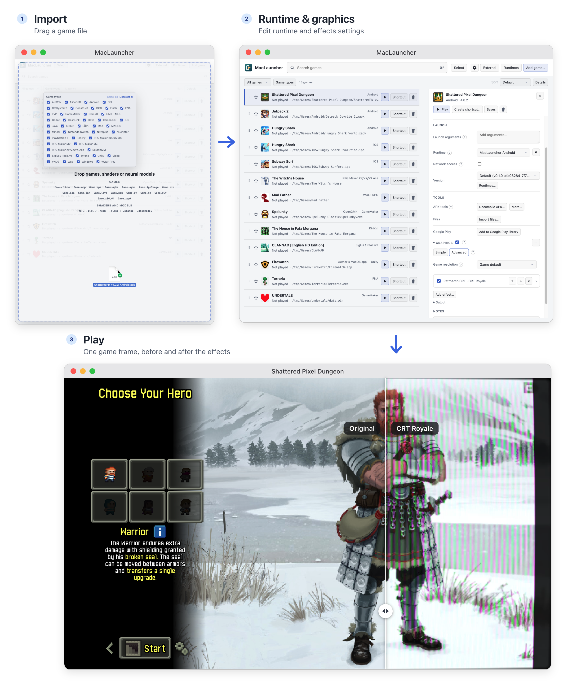

import { Card, CardGrid, LinkCard } from "@astrojs/starlight/components";
import DemoEmbed from "../../components/DemoEmbed.astro";

The demo below runs the launcher's interface in your browser, with a library of example games. Each button shows what it would do, along with the article that explains it.

<DemoEmbed />

## Three things in one

<CardGrid>
  <a class="homeCard" href="/maclauncher/games/">
    <Card title="Native runtimes" icon="rocket">
      Many Windows games don't need Windows. MacLauncher detects the engine and
      version, fetches a macOS runtime for it, and plays the game natively. It also
      runs Android, iOS, PS5 and Switch games without emulation.
    </Card>
  </a>
  <a class="homeCard" href="/maclauncher/graphics/">
    <Card title="Graphics and effects" icon="seti:image">
      Upscalers, frame generation, neural models and any ReShade, RetroArch or mpv
      shader, stacked in any order and changed live, for every runtime.
    </Card>
  </a>
  <a class="homeCard" href="/maclauncher/tools/">
    <Card title="Tinker tools" icon="setting">
      Download any version you own from Steam, GOG, Epic, itch.io and Google Play.
      Snapshot and edit saves, use cheats, and decompile most engines.
    </Card>
  </a>
  <a class="homeCard" href="/maclauncher/help/faq/#does-it-change-my-game-files">
    <Card title="Yours, locally" icon="approve-check">
      Original files are never modified, every runtime is versioned, and nothing
      goes online unless you ask.
    </Card>
  </a>
</CardGrid>

## Built in the open

Everything MacLauncher builds itself, the app and every package compiled for it in [MacLauncher Builds](https://github.com/procrastinine/maclauncher-builds), is built on GitHub's own machines from public source code and public recipes. GitHub signs a record of exactly which source and recipe produced each file, so nothing can be slipped into a download that isn't in the public source, and anyone can read that source, check a download against its record or rebuild it. Components taken unchanged from their publishers, such as Python, Electron and Adobe's Flash Player projector, keep the publisher's version and are checked against the publisher's own files, checksums or signatures. MacLauncher sends no telemetry, and its diagnostics stay in a log file on the Mac.

[How can I be sure nothing was added?](/maclauncher/help/faq/#how-can-i-be-sure-nothing-was-added-to-maclauncher) explains what the records prove, [How do I check a download myself?](/maclauncher/help/faq/#how-do-i-check-a-download-myself) shows the one-command check, and the [package verification table](https://procrastinine.github.io/maclauncher-builds/verification.html) lists every package's record, including the few older versions built locally before this setup.

## Start exploring

<CardGrid>
  <LinkCard title="What is MacLauncher?" href="/maclauncher/introduction/" description="The longer introduction." />
  <LinkCard title="How games run on a Mac" href="/maclauncher/background/how-games-run/" description="VMs, emulators, WINE and native runtimes, explained." />
  <LinkCard title="Games and runtimes" href="/maclauncher/games/" description="Everything MacLauncher can play, by game type, and the runtimes that play it." />
  <LinkCard title="Graphics and effects" href="/maclauncher/graphics/" description="Shaders, upscaling and frame generation, with examples." />
</CardGrid>
