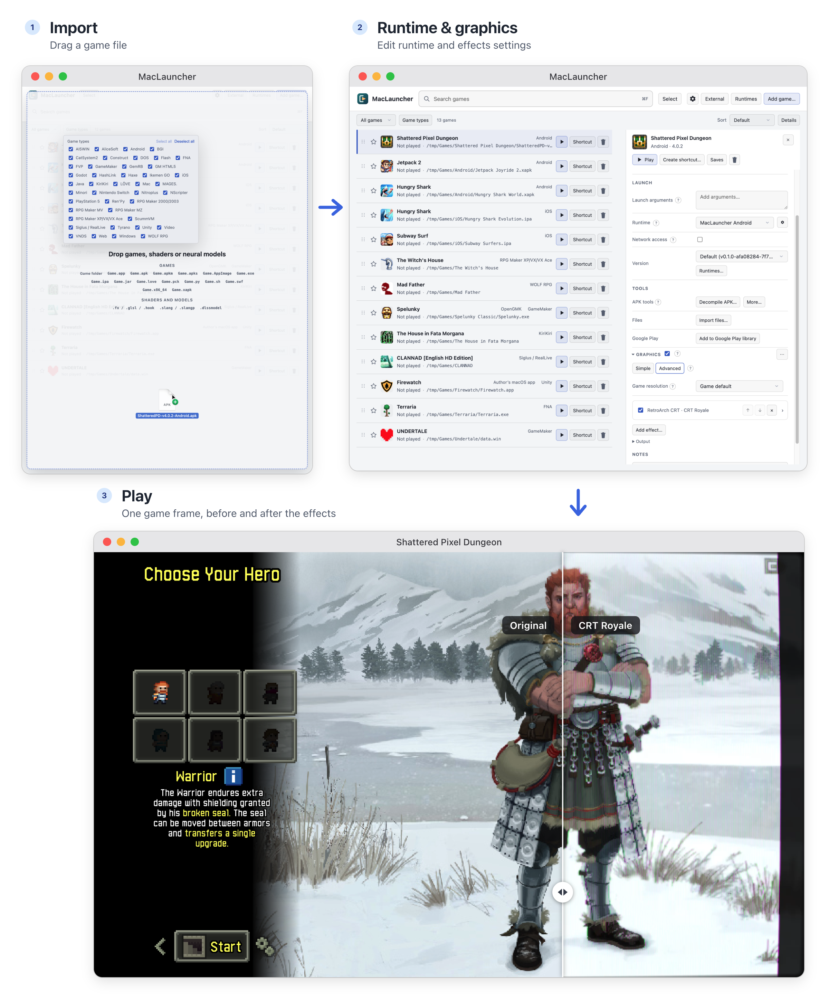

MacLauncher is three things at once: a **native runtime system**, a **graphics and effects layer**, and a **tinker tool** for playing games on macOS. You can use any one of them on its own, but they're designed to work together.

*The Android version of [Shattered Pixel Dungeon](https://github.com/00-Evan/shattered-pixel-dungeon), running with [CRT Royale](https://github.com/akgunter/crt-royale-reshade) shaders.*

## A native runtime system

Here's a fact that surprises a lot of people: many games packaged for Windows don't actually need Windows. They are built on engines like [Ren'Py](https://www.renpy.org/), [RPG Maker](https://www.rpgmakerweb.com/), [Godot](https://github.com/godotengine/godot) or [GameMaker](https://gamemaker.io/), and those engines, or faithful open-source reimplementations of them, run natively on macOS. Point the Mac engine at the game's data and it just plays, with no [WINE](https://www.winehq.org/) and no emulation.

Doing that by hand means identifying the engine, finding the right build, matching the exact version, and configuring it. MacLauncher does all of it automatically. Drag in a game folder or `.exe`, and it detects the engine and version, picks the runtime most likely to work, downloads it when you press Play (after asking), and launches the game. You can always pick a different runtime or version yourself.

Why bother, when [CrossOver](https://www.codeweavers.com/crossover/) exists?

- **Speed and efficiency.** No translation layer between the game and your Mac.
- **It behaves like a Mac app.** Windows, fullscreen, mouse and audio work the way macOS expects, instead of the occasional weirdness of WINE.
- **Broken Mac builds become playable.** Some games ship a Mac app that fails on signing or packaging. A working runtime pointed at the same data side-steps that.

And it doesn't stop at Windows games. Android and iOS apps, PlayStation 5 and Nintendo Switch games, DOS games, 32-bit Mac apps, Flash, Java and dozens of visual-novel engines all have runtimes too. Where no native runtime exists, MacLauncher manages [Sikarugir](https://github.com/Sikarugir-App/Sikarugir) (free WINE) and your own CrossOver as a fallback.

→ [How games run on a Mac](/maclauncher/background/how-games-run/) explains the ideas, and [Games and runtimes](/maclauncher/games/) shows what's supported.

## A graphics and effects layer

MacLauncher has its own graphics pipeline, running natively on [Metal](https://developer.apple.com/metal/), that works with **every** runtime: native engines, WINE games, Android apps, consoles, videos, even ordinary Mac apps. You can stack effects in any order and change them live while the game runs:

- spatial and temporal upscalers, from [MetalFX](https://developer.apple.com/documentation/metalfx) and [AMD FSR](https://github.com/GPUOpen-LibrariesAndSDKs/FidelityFX-SDK) to neural upscalers like [Real-ESRGAN](https://github.com/xinntao/Real-ESRGAN);
- frame generation, including a macOS port of [Lossless Scaling](https://store.steampowered.com/app/993090/Lossless_Scaling/)'s (using your own copy of the app);
- neural reconstruction and restoration;
- and any [ReShade](https://reshade.me/), [RetroArch](https://www.retroarch.com/), [mpv](https://mpv.io/)/[libplacebo](https://libplacebo.org/), [Magpie](https://github.com/Blinue/Magpie) or [ISF](https://isf.video/) shader you care to import: CRT effects, color grading, anti-aliasing, depth effects and more.

Want to run a game at 720p, push it through a neural model, upscale it to 4K, add frame generation and finish with a CRT filter? That's one chain of effects, edited live.

→ [Graphics and effects](/maclauncher/graphics/) shows what's possible, with examples.

## A tinker tool

These are *your* games, on *your* disk, and MacLauncher is built to give you as much control as possible:

- **Versions for everything.** Keep several versions of any runtime and pick per game.
- **Stores without limits.** Download the games you own from [Steam](https://store.steampowered.com/), [Epic](https://store.epicgames.com/), [GOG](https://www.gog.com/), [itch.io](https://itch.io/) and [Google Play](https://play.google.com/store/games), in the platform and version you choose, such as the Windows build of a Steam game, or an older release.
- **Tools.** Save snapshots and editors, cheats for RPG Maker and Ren'Py, and decompilers and extractors for most engines.
- **Fine-grained settings.** Every runtime option, custom launch arguments, and a per-game network switch.
- **No background network traffic.** Every request comes from something you did. MacLauncher doesn't phone home.

→ [Tinker tools](/maclauncher/tools/) has the tour.

## Open source

MacLauncher is open source under the [MIT license](https://github.com/procrastinine/maclauncher/blob/master/LICENSE), and it stands on the shoulders of a lot of other open-source projects, credited in the [attributions](https://github.com/procrastinine/maclauncher/blob/master/docs/ATTRIBUTIONS.md). Runtime builds that need adapting for macOS live in the companion project [MacLauncher Builds](https://github.com/procrastinine/maclauncher-builds).

Ready? [Get started](/maclauncher/getting-started/).
