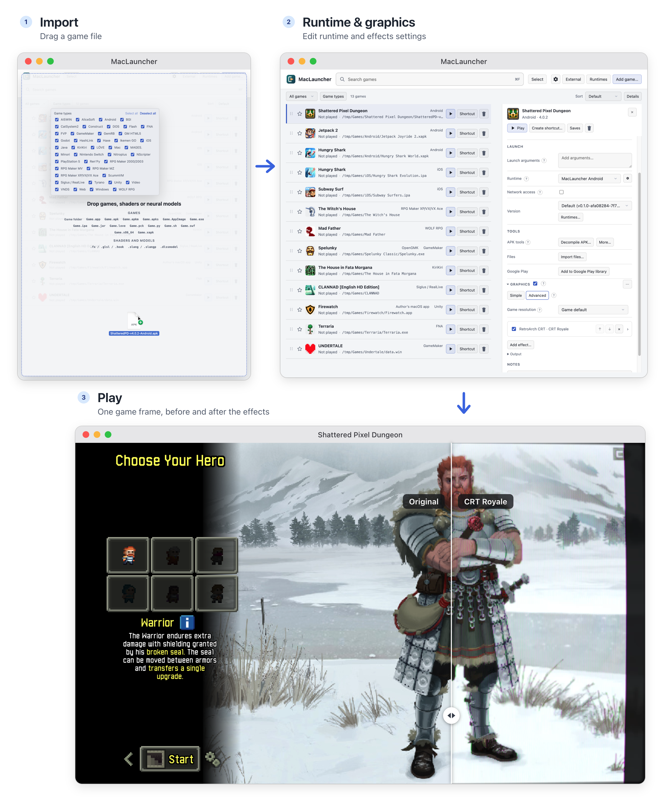

MacLauncher plays games on macOS, and it does that in three roles at once: it's a native runtime system, a graphics and effects layer, and a patch/tinker tool. You can lean on any one of them alone or use all three together.

*The Android version of [Shattered Pixel Dungeon](https://github.com/00-Evan/shattered-pixel-dungeon), running with [CRT Royale](https://github.com/akgunter/crt-royale-reshade) shaders.*

## A native runtime system

<video src="/maclauncher/videos/runtime-compatibility.mp4" poster="/maclauncher/videos/runtime-compatibility.jpg" controls preload="metadata" playsinline></video>

*The Penjikent Creature, a [Godot](https://github.com/godotengine/godot) game packaged for Windows, dragged in as its `.exe`. MacLauncher detects Godot 3.5.2, downloads the matching runtime after asking and plays the game natively, without WINE. The installed Godot versions are then managed in **Runtimes**.*

Many games packaged for Windows don't need Windows at all. They're built on engines such as [Ren'Py](https://www.renpy.org/), [RPG Maker](https://www.rpgmakerweb.com/), [Godot](https://github.com/godotengine/godot) or [GameMaker](https://gamemaker.io/), and those engines, or faithful open-source reimplementations of them, run natively on macOS. The Mac version of the engine can read the game's data directly, so the game runs without [WINE](https://www.winehq.org/) and without emulation.

Doing that by hand means identifying the engine, finding a build of the exact version the game needs and configuring it. MacLauncher automates these steps. When you drag in a game folder or `.exe`, it detects the engine and its version and picks the runtime most likely to work. Pressing Play downloads that runtime after asking and launches the game. You can always choose a different runtime or version yourself.

Even if you have [CrossOver](https://www.codeweavers.com/crossover/), a native runtime is usually the better way to play. No translation layer sits between the game and your Mac, so it tends to run faster and use less power. Windows, fullscreen, mouse input and audio behave the way macOS expects, without the occasional oddities of WINE. A game whose own Mac build fails to open because of signing or packaging problems can often still be played, because a working runtime reads the same game data.

Runtimes aren't limited to Windows games. Android and iOS apps, PlayStation 5 and Nintendo Switch games, DOS games, 32-bit Mac apps, Flash, Java and dozens of visual-novel engines have them too. Several exist only in MacLauncher, such as its own Android runtime for complex commercial and VR games, a macOS port of the GameMaker classic runner OpenGMK and a macOS port of the PS5 runtime AnyPS5. For [Windows games with no native option](/maclauncher/windows/), MacLauncher manages [Sikarugir](https://github.com/Sikarugir-App/Sikarugir), a free distribution of WINE, and can also use your own copy of CrossOver. Ports of individual games from [decompilation and recompilation projects](/maclauncher/help/faq/#what-about-decompilation-and-recompilation-ports), mostly older console games, are a different kind of project, and their macOS builds can be dragged in like any other Mac app.

[How games run on a Mac](/maclauncher/background/how-games-run/) explains the ideas behind these runtimes, and [Games and runtimes](/maclauncher/games/) shows what's supported.

## A graphics and effects layer

<video src="/maclauncher/videos/graphics.mp4" poster="/maclauncher/videos/graphics.jpg" controls preload="metadata" playsinline></video>

*The DOOM 3 demo running natively through [dhewm3](https://github.com/dhewm/dhewm3). A CRT filter and grayscale in the Simple view, with the split and difference views, then a DLSS chain in the Advanced view: downsample to 540p, DLSS 5, MetalFX back up to the window, and Lossless Scaling frame generation at 4x. The performance overlay shows about 15 fps coming out of DLSS turning into 60 fps on screen, and DLSS and frame generation are switched off and on again live.*

MacLauncher has its own graphics pipeline, built natively on [Metal](https://developer.apple.com/metal/), and it works with every runtime: native engines, WINE games, Android apps, consoles, videos and ordinary Mac apps. It can even process another app's window, or a whole display, that isn't running inside MacLauncher at all. You can stack effects in any order and change them while the game runs. The effects include:

- spatial and temporal upscalers, from [MetalFX](https://developer.apple.com/documentation/metalfx) and [AMD FSR](https://github.com/GPUOpen-LibrariesAndSDKs/FidelityFX-SDK) to DLSS and neural upscalers such as [Real-ESRGAN](https://github.com/xinntao/Real-ESRGAN);
- frame generation, including a macOS port of [Lossless Scaling](https://store.steampowered.com/app/993090/Lossless_Scaling/)'s, which uses your own copy of the app;
- neural reconstruction and restoration, DLSS 5 among them;
- any [ReShade](https://reshade.me/), [RetroArch](https://www.retroarch.com/), [mpv](https://mpv.io/)/[libplacebo](https://libplacebo.org/), [Magpie](https://github.com/Blinue/Magpie) or [ISF](https://isf.video/) shader you import, such as CRT effects, color grading, anti-aliasing and depth effects.

A single chain can render a game at 720p, pass it through a neural model, upscale it to 4K, add frame generation and finish with a CRT filter, and you can edit every step while you play. A preset saves the whole chain for other games, a performance overlay shows what each step costs, and a video can be exported with the same effects applied.

[Graphics and effects](/maclauncher/graphics/) has examples of each kind of effect, and [Window graphics](/maclauncher/graphics/window-graphics/) covers other apps' windows and displays.

## A patch/tinker tool

MacLauncher is also a tool for patching and tinkering with the games on your disk and the software that runs them. Three principles shape this part:

- **Version management.** You pick the version of everything that has one: each runtime, each graphics translator and Vulkan driver, and even the version and platform of a game you download from a store. Choices come from a catalog or your own files, and a sensible default covers anything you leave alone.
- **Unchanged source.** MacLauncher leaves your games and the apps it builds on as they are. The few game types that need files in the game folder for saves, cheats or mods get managed patches, which are tracked and can be undone. CrossOver, Sikarugir and Steam are never patched.
- **As much power to the user as possible.** Every decompiler and cheat tool available for a game type, every runtime setting and launch flag, and environment variables for every translator, as defaults and per game. Your files stay yours, nothing goes online without an action of yours, and there's no telemetry.

In practice, that means you can keep several versions of any runtime and choose one per game, and give each Windows game its own [DXVK](https://github.com/doitsujin/dxvk), [vkd3d-proton](https://github.com/HansKristian-Work/vkd3d-proton) and Vulkan driver inside CrossOver or Sikarugir, including MacLauncher's own build of KosmicKrisp. You can download the games you own from [Steam](https://store.steampowered.com/), [Epic](https://store.epicgames.com/), [GOG](https://www.gog.com/), [itch.io](https://itch.io/) and [Google Play](https://play.google.com/store/games) in the platform and version you choose, such as the Windows build of a Steam game or an older release, and let Windows games use the Steam app for Mac through a bridge. Save snapshots and editors, cheats for RPG Maker and Ren'Py, and decompilers and extractors for most game types are there too.

[Patch and tinker tools](/maclauncher/tools/) explains the three principles with examples, [Runtime patching](/maclauncher/tools/runtime-patching/) explains why swapping translators helps, and [Network and privacy](/maclauncher/tools/network-and-privacy/) covers when MacLauncher goes online.

## Open source

MacLauncher is open source under the [MIT license](https://github.com/procrastinine/maclauncher/blob/master/LICENSE), and it builds on many other open-source projects, which are credited in the [attributions](https://github.com/procrastinine/maclauncher/blob/master/docs/ATTRIBUTIONS.md). Runtime builds that need adapting for macOS live in the companion project [MacLauncher Builds](https://github.com/procrastinine/maclauncher-builds), and both the app and those builds can be [verified](/maclauncher/help/faq/#how-can-i-trust-maclauncher-binaries) against their source.

To install MacLauncher and play your first game, see [Getting started](/maclauncher/getting-started/).
